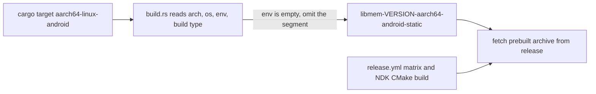

libmem is a C and C++ library by rdbo for working with process memory, with bindings for Rust and Python, under AGPL-3.0. I needed it in a project that mixes Rust and Kotlin on Android, and libmem had no Android target. So I added one. The pull request (rdbo/libmem#302, "Add CI and build support for Android") was opened on July 20 and merged by the owner on August 30. It has two commits and touches four files, with 138 lines added and 4 removed.

This post covers the cross-compilation side: what the Rust `-sys` crate assumes about a target, the bug I hit first, and what the CI I added proves and does not prove.

## What libmem-sys assumes about the target

The `libmem-sys` crate has a `fetch` feature. Its `build.rs` reads the Cargo target configuration, builds the name of a prebuilt archive, and downloads that archive from the project's GitHub release. The name is made of the version, the architecture, the OS, an environment string and the build type, for example `libmem-<version>-x86_64-linux-musl-static`. On Linux with the `static` feature the script even forces the environment to `musl`, so every static Linux build maps to one archive.

Android has no such override. The name is assembled from whatever Cargo reports for the target.

## The empty target_env

On `aarch64-linux-android`, `CARGO_CFG_TARGET_ENV` is an empty string. The format string did not care, so the archive name came out with two dashes in a row: `libmem-<version>-aarch64-android--static`. No such file exists on the release page, so the `fetch` step asked for a URL that could never resolve.

The fix is a condition that leaves the segment out when it is empty:

```rust
let release_target = if target_env.is_empty() {
    format!("libmem-{}-{}-{}-{}", version, target_arch, target_os, build_type)
} else {
    format!("libmem-{}-{}-{}-{}-{}", version, target_arch, target_os, target_env, build_type)
};
```

The crate already had a unit test for these names. I added a case that takes `["1337", "android", "aarch64", "", ""]` and expects `libmem-1337-aarch64-android-static`. Now a regression in the name fails a unit test, where before it showed up as a failed download in someone else's build.



## Link libraries

Linux links `dl`, `m` and `stdc++`. The Android branch links `dl`, `m` and `c++_shared`, because I build libmem against the NDK's shared C++ runtime. That has a consequence for the app using it: `libc++_shared.so` has to be packaged in the APK next to the Rust library.

## Building with the NDK toolchain

The release script `tools/build-release.sh` got an `_build_android` function. It refuses to run unless `ANDROID_NDK_ROOT` points at an installed NDK. The CMake configuration for Android gets the NDK's toolchain file, `ANDROID_ABI=arm64-v8a`, `ANDROID_PLATFORM=android-26`, `ANDROID_STL=c++_shared` and position-independent code. The script derives the ABI from the target name and exits with an error for anything it does not recognise, which today means everything except `aarch64`.

In `release.yml` the build matrix has a new entry, `aarch64-android-static`. For that entry only, the job installs Java 17 and the Android SDK with `android-actions/setup-android@v3`, then NDK `27.0.12077973` and CMake `3.22.1` through `sdkmanager`. The other targets run as before, because each of those steps is conditional on the target name containing `-android-`.

## What CI proves and what it does not

I added a second workflow, `rust-android-test.yml`. It builds the static library with the NDK toolchain, then goes into `bindings/rust` and runs `cargo test --no-run --target aarch64-linux-android` with the NDK's clang as the linker. That compiles the bindings and links the test binary against the library. It does not execute anything, because a GitHub runner has no Android device. The workflow is also manual only (`workflow_dispatch`), so it does not run on every push.

A green run tells you that the symbols resolve and the link line is correct. It says nothing about behavior on a device. I checked that by hand on Android 16 hardware, and that check is not part of the repository.

## The upstream review

The pull request sat for 41 days between opening and merge. The diff stays inside what was already there: the existing script, the existing release matrix and the existing unit test. The new target sits next to the old ones with the same naming. Four files with one reason each made it easy for the owner to read, and I think that mattered more for the outcome than anything clever in the change.

My fork's `master` does not contain the merge commit yet, because the fork lags upstream and I have not synced it.

## What is still open

Only `aarch64-android` exists. An x86_64 emulator image would need another ABI in the script and another matrix entry. The link test cannot catch runtime problems, so any future change on this path needs a run on a real phone, and I have done that on one device only. The link workflow could also run on pull requests instead of on demand, which would catch a broken Android link line sooner. I have not proposed that change.
