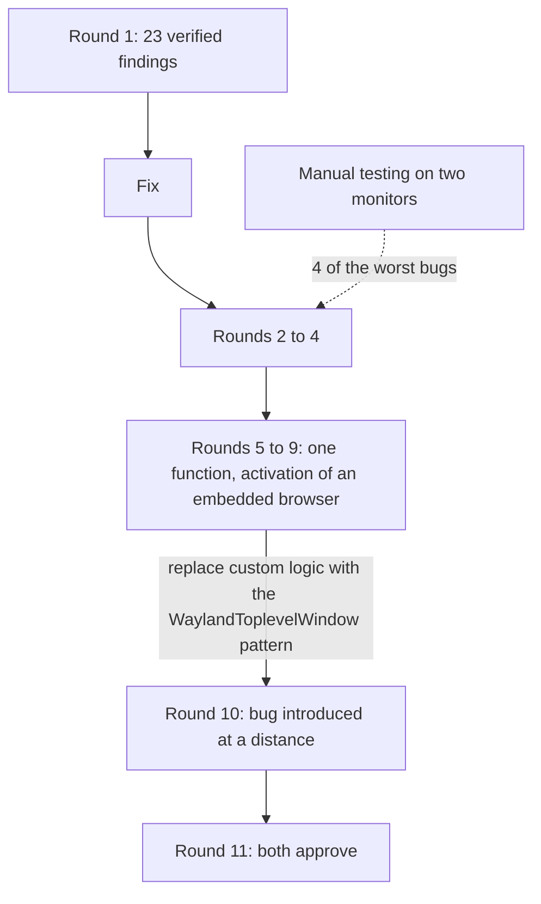

I wrote my Wayland embedding patch for CEF with heavy help from Claude Code. The commits say so in an `Assisted-by: Claude Code` trailer, because CEF's AI policy requires it, and I take responsibility for what is in them. I had the branch reviewed by two other AI reviewers (Codex and Kimi, as named in my notes), and I added my own manual testing on top. It took 11 rounds. I kept a findings log of 1,155 lines, and this post is what is in it.

The pull request (chromiumembedded/cef#4233) is still open and not merged. The maintainer reviewed it on October 20 and asked for design changes, so some of the code I hardened here will be rewritten. I will come back to that at the end.

## The setup

The branch has five commits: the Chromium patch for Ozone, the CEF API and runtime platform selection, windowed browsers on Wayland, a sample, and design notes. Each round produced findings, and the log marks each one as verified or as a false positive.

Across the 11 rounds the log counts 45 verified findings and 7 false positives. Round 1 alone had 23 verified findings: 5 blockers, 8 major and 10 minor. The blockers were a broken macOS build, a close that never completes, keyboard focus that does not alternate between two browsers, a null `parent_xdg_surface` that kills the process, and an out-of-bounds read when a caller uses the Stable API.

In round 1, Codex had 4 false positives, all the same mistake: it read diff context lines as trailing whitespace. Kimi had 3. Kimi also gave seven LGTM rounds, and my log's conclusion is that an LGTM count measures how high a reviewer sets its threshold, which says little about the code. Neither reviewer replaced the other, and neither replaced running the code. One of them never updated its state between rounds and repeated a refuted false positive four times. The other stopped searching early, though it once retracted a finding in writing.

## What static review found and what only clicking found

The reviewers found what a careful reading of a diff can find: wrong ownership, a missing null check, a build error on a platform I cannot build on. Four of the worst defects came from me clicking, dragging and moving the window between my two monitors. They live in behavior that exists only when things move: a browser at an offset, two browsers, a window that crosses to a screen with a different scale. Almost everything that broke was something a single browser at (0,0) covering the whole window never exercises.

## The function that took five rounds

Activation of an embedded browser, meaning how it gets keyboard focus, went through five consecutive rounds. Every fix exposed the next defect in the same function. I was writing custom logic for something Chromium already solves for its own windows. It converged only when I stopped and copied what `WaylandToplevelWindow` does: derive the state from the seat, notify through the window manager's path, and defer the action rather than the notification.

A patch that has to explain why it differs from upstream is probably wrong. I should have looked for the equivalent mechanism in the first of those five rounds.

I also made a mistake of the same kind in my own repairs. A first "graceful degradation" for a null `xdg_surface` aborted the process the same way the null pointer had. And one fix was half done: a special case sat in a helper shared by two code paths that used different coordinate spaces, an `xdg_popup` anchored on the host surface and a bubble subsurface of the embedded browser. It was harmless until the bubble fallback existed.

## The bug no diff contained

In round 10, a correct change in one file made two inert calls in another file destructive. Not one line of the second file changed. A diff-based review, whether Gerrit, GitHub or an AI reading a patch, cannot see that, because the broken code is not in the diff. A reviewer's note in the log says that function had been read for three or four rounds without the problem being noticed.

Since then, whenever I change a shared helper I read its other callers, even if their files are not in the diff.

## Tests that pass for the wrong reason

False coverage showed up six times, in three forms. A test passed because no keyboard was plugged in, so activation fell through to a different tier than the one I meant to test. A test asserted an intermediate state when it should have asserted what an observer sees. And one drained the event queue at exactly the point where the race lives.

I ended with 34 automated tests, 30 on the Ozone `WaylandTest` harness and 4 on the ABI of `cef_window_info_t`. I verified each by reintroducing the bug it covers and checking that it fails. The Chromium suite of 476 Wayland tests still passes. For proportion, the log notes that none of the 116 Chromium patches CEF carries has tests and none adds a new file.

One of the ABI tests found a real bug. `CefStructBase::Set()` calls `Clear()` to clear newer members, but the traits `clear()` only frees strings, so a stale `parent_xdg_surface` pointer survived an assignment from a smaller struct. The upstream code has the same gap for members that already exist.

Formatting showed up as a finding too. A first revision carried 150 lines of formatting churn, and removing it shrank the patch from 1,243 to 1,155 lines. The rule I settled on is to run `clang-format` only on files the patch introduces.

## The checklist I keep now

- Write down what an observer would see before writing the test, and break the code on purpose to watch the test fail.
- Look for the equivalent mechanism in the code I am extending before writing custom logic.
- After changing a shared helper, read all of its callers, including those outside the diff.
- Test with two browsers, an offset and two monitors of different scale, since one browser at the origin hides most bugs.
- Count false positives for each reviewer, and treat a long run of LGTM as information about the reviewer.

## Where it stands

PR #4233 is open. The maintainer's October 20 review reversed several design choices, including how the parent surface is passed, so part of what these rounds polished will change. Which of the 34 tests survive the redesign, I do not know yet.
