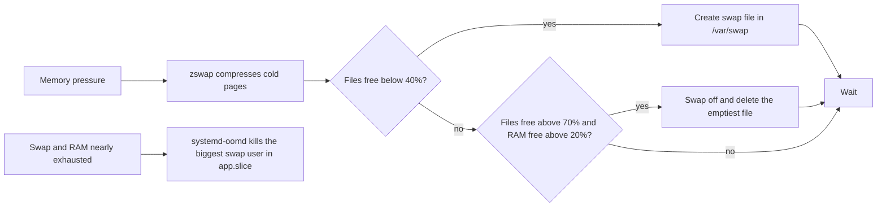

macOS does not ask how much swap you want. It starts small and grows the swap when memory runs low. On a typical Linux desktop the size is decided once, at install or by a generator, and stays there. For LuminusOS I wanted the macOS behavior: compress cold pages in RAM first, and spill to disk only when that is not enough, with the disk part growing and shrinking by itself.

This post is about elastic-swap, the daemon I ended up with. It is a fork, and most of what I changed exists because the root filesystem is read-only.

## Where it started

My first version was an interim service, `luminusos-swapfile.service`. It created a fixed `/var/swap/swapfile` on Btrfs, half of RAM, between 2 and 16 GiB, and the image enabled zswap with zstd. It worked, but the size came from the amount of RAM and not from how much swap anyone needed.

Writing a swap-file controller from scratch is the kind of work that looks short and is not. The hard part is deciding when to create a file and when to remove one without causing a storm of swap-off operations, and those thresholds have to be measured. Somebody had already done it. biglinux-systemd-swap is an active Rust rewrite of Nefelim4ag's Python systemd-swap, with a controller of about 1,300 lines and the invariants documented. Both are GPL-3.0, so I forked it, kept the attribution, and named my fork elastic-swap. It is about 8,000 lines of Rust at version 0.2.4.

The name collides with an unrelated DeFi project that was exploited in December 2021, so web searches for it are a mess. I decided to keep the name anyway and document the problem. I also skipped the stock name `systemd-swap`, because Fedora ships a package with that name and it would conflict in `/usr/bin`.

## The model

The default mode is zswap plus swap files. The kernel's zswap compresses cold pages into a pool limited to 45% of RAM. When the pool fills, the shrinker writes the compressed pages out to swap files under `/var/swap`. Zswap needs a disk-backed device to write to, so the files are not optional in this mode. The image also sets `vm.swappiness=100`, `vm.watermark_boost_factor=0`, and the kernel arguments `zswap.enabled=1 zswap.compressor=zstd`.

The daemon checks every second while swap files exist. It creates a file when the free space in the files falls under 40%. It removes one when that free space is over 70% and free RAM is over 20%. The removal picks the emptiest file, and only if the remaining files would still be at least 55% free. That margin sits 15 points above the creation threshold so that deleting a file cannot immediately trigger the creation of a new one. After any creation or removal it waits 60 seconds, or 300 in zswap mode.

File sizes grow with the count. On Btrfs, where preallocation is cheap, the first 8 files are 512 MB, the next 8 are 1 GB and the rest are 2 GB. Twenty-four files add up to 28 GB when no other swap area is active. The limit of 24 is the kernel's: it accepts a fixed number of swap areas at once and refuses a `swapon` past that with `Operation not permitted`. That was 24 on the one kernel I measured, 7.2.11. This is why the files get bigger instead of just more numerous.

## What a read-only root broke

Most of the fork's assumptions were about a normal mutable system. Four of them failed on LuminusOS.

The default swap path was `/swapfile` and the unit only allowed writes there. The root of the image is read-only, so the path became `/var/swap`.

A bash helper, `pre-systemd-swap`, edited `/etc/fstab`. The image does not write fstab, so it was dropped, and the daemon never touches that file. Reading the helper properly showed that it also set `vm.min_free_kbytes` and put transparent huge pages in `madvise` mode. Removing it would have lost both quietly. The daemon now computes and writes `min_free_kbytes` itself in Rust, and a tmpfiles rule sets THP.

The third one took me longest. `/var/swap` should be a Btrfs subvolume with copy-on-write disabled, which avoids a deadlock under memory pressure. My first idea was a `tmpfiles.d` rule with the `v` type. The systemd man page says `v` creates a subvolume only if the root directory is itself a subvolume, and the root of a composefs image is not. It would have created a plain directory without telling me.

The fourth is the sandbox. With `ProtectSystem=strict` and `ReadWritePaths`, `/var/swap` becomes a bind mount inside the daemon's namespace. When the daemon tried to remove an empty directory that was not a subvolume, `remove_dir_all` returned `EBUSY` on the mount point and the service failed to start. The fix was a separate oneshot unit, `elastic-swap-prepare.service`, which creates the subvolume with no mount sandbox before the daemon starts. The daemon stays sandboxed, and its removal became a plain `rmdir` that tolerates `EBUSY`.

I decided against upstreaming any of this into systemd's new Rust support. It is built with Meson, takes leaf programs only, and is LGPL, and my code is a GPL-3.0 derivative with a Cargo project and crate dependencies. Fedora 45 ships systemd 262 anyway.

## The zram trap

The fork also has a dynamic zram pool, and it stays as a selectable mode. The fork's documentation describes a failure I do not want to see on a user's machine. A zram device advertises a size, but the memory behind it depends on how well the data compresses. When the pool reaches its memory limit, writes to the device start failing. The kernel function `should_reclaim_retry()` still counts the slots that nothing can back as free swap, so reclaim keeps aiming at the same device instead of falling through to the swap files.

In a VM, a pool that advertised a 3.0x ratio met data that compressed at 1.02x. The log filled with 1.5 million `Write-error on swap-device` lines, the swap files stayed at 0 bytes, and the machine hung without an OOM kill. The sizing rules in the pool now only add slots that the remaining RAM could back if the next data did not compress at all. The shipped default is still zswap plus swap files, and zram is something you select on purpose.

## When swap runs out

Swap that grows has a ceiling too. For that I added a drop-in for the user's `app.slice` with `ManagedOOMSwap=kill`, so systemd-oomd kills the application using the most swap when it runs out. GNOME Shell lives in `session.slice` and is deliberately not a candidate. I would rather lose a browser than the session.

## A review and what is still open

The daemon has `#![deny(unsafe_code)]` and a single `libc::swapoff` call, and it never writes fstab. A review pass by critics that had not written the code failed the first round on correctness, security and license. Two of the findings were a `remove_dir_all` on a path reachable through a racing symlink and a string denylist that `..` and `//` got around. The second round passed, and the tests went from 173 to 187.

The RPM ships in the workstation image, pinned by version and checksum. What I have not finished is the validation I would trust on a machine I care about. A stress run on real hardware and a run with SELinux enforcing were still open when I wrote the last notes. Until those are done, I consider the whole setup unproven on real hardware.
