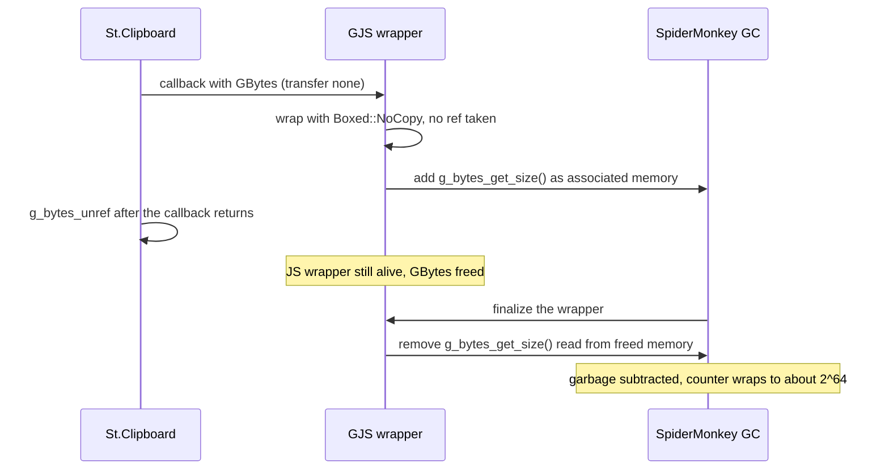

Aurora Shell is the GNOME Shell extension I write for LuminusOS. In September I was porting it to GNOME 51 when it started doing something I could not explain: after one or two screenshots the whole shell froze. I fixed the first cause and the freeze went away, but the shell stayed slow. Animations stuttered, mostly when the dock slid in. Nothing brought it back except logging out.

This post is about how I found out why. It took a GC profile and a long list of crossed-out hypotheses.

## The freeze that was my fault

The complete freeze was a bug in the dock. `updateAutoHide()` polled every 100 ms, without end, at the default main loop priority, while a window blocked autohide. Once each tick started taking about 110 ms, the timer was always ready and the redraw never got to run. I moved the polling to idle priority and made it run only while a menu is open. The freezes stopped.

The sluggishness stayed. That meant a second problem, and it behaved like a state that, once entered, never leaves.

## Measuring the garbage collector

Turning on SpiderMonkey's GC profiler (`JS_GC_PROFILE=0`) gave me the first hard numbers. A normal session shows a periodic `MEM_PRESSURE` collection every 10 seconds. After the screenshots, within a few minutes the log had 4,354 collections tagged `TOO_MUCH_MALLOC` and 1,661 tagged `EAGER_ALLOC_TRIGGER`.

The profile has a column for the malloc counter, `MllcKB`. It sits around 10 MB in a healthy session. Right after the second screenshot, at the next periodic GJS collection, it read 18014169870309330 KB. That is about 2^64. Something had subtracted more associated memory than anyone had added, and the unsigned counter wrapped around. From then on, the engine believed it had an enormous amount of external memory allocated, so every JS allocation triggered a full GC. The JS heap itself stayed at about 24 MB the whole time. That explains why turning modules off or disabling the extension afterwards changed nothing: the damage was in the counter.

## Crossing things out

Before I trusted that, I had a list of things I had ruled out:

- Crashes, OOM and GPU errors: nothing in the journal, coredumpctl or the kernel log.
- A deadlock in mutter or the driver: a watchdog probing over D-Bus showed the main loop alive.
- Leaked handlers or JS objects: heap dumps before and after were 24.5 and 24.6 MB.
- Memory pressure on the system: PSI at 0, 26 GB free, no LowMemoryMonitor signals.
- GdkPixbuf accounting in GJS 1.89.2: I read `gi/object.cpp` and `gjs/mem.cpp` and tested three ways of creating a pixbuf. The counter stayed balanced.
- Reproducing in a headless Shell in a toolbox: two screenshots through the real UI, then a forced GC. Malloc stayed at about 7.7 MB.

The last row only told me that a headless run was not going to show me this bug.

## The test that isolated it

The next step was to disable a module before the screenshots instead of after. Turning things off after the slowdown starts proves nothing, because the counter has already wrapped. In a clean session, with the extension on and Clipboard History off, I took two screenshots. The watchdog probe never went above 19 ms, even 45 seconds later. With Clipboard History on, the shell always became slow.

The monitor in Clipboard History reads the whole image from the clipboard on every `owner-changed` signal, and a screenshot puts one there.

## What GJS does with that image

The monitor used `St.Clipboard.get_content()`. Its callback receives a `GBytes` with transfer none: the callee does not own it and must not keep it past the call. This is what happens in 1.89.2:



GJS wraps a transfer-none boxed value with `Boxed::NoCopy`, so the wrapper holds a pointer without a reference. When it creates the wrapper, `StructInstance::add_associated_memory` registers the size of the `GBytes`, which for a screenshot is megabytes. Right after the callback returns, St unrefs the `GBytes` and frees it. The JS wrapper is still there. When the GC finalizes it, `remove_associated_memory` calls `g_bytes_get_size()` again on memory that no longer belongs to anyone. In a real session that memory has been reused, so the value is garbage, and subtracting it wraps the counter.

The headless runs from earlier were misleading for two reasons. My toolbox had GJS 1.89.90, which already has the accounting reverted, so there was no counter to corrupt. And freed memory in a quiet process often stays intact, so even a second read of the size can return the old value. When I kept the bytes from the callback and read the size afterwards, the toolbox did crash deterministically, with garbage sizes and a double free. That case is still there on GJS main.

## The fix

I stopped using `get_content()` for images. The monitor now asks Mutter's selection object to transfer the clipboard content into a stream that I own:

```typescript
const selection = global.display.get_selection();
const stream = Gio.MemoryOutputStream.new_resizable();
selection.transfer_async(
  Meta.SelectionType.SELECTION_CLIPBOARD,
  mimeType,
  MAX_IMAGE_BYTES + 1,
  stream,
  this._cancellable,
  (_selection, result) => {
    selection.transfer_finish(result);
    const bytes = stream.steal_as_bytes();
    // ...
  },
);
```

`steal_as_bytes()` returns a `GBytes` with transfer full, so the wrapper owns the memory and the size it reads at finalization is the one it registered. The transfer also takes a `Gio.Cancellable`, which I cancel when the module is destroyed. The shell test now spies on `transfer_async`, and a mutation test confirms it catches a regression to the old read.

I validated it in a fresh session with Clipboard History on. Two screenshots were stored in the history with thumbnails, the probe never went above 22 ms in 38 measurements, and the panel and the dock behaved normally.

## Upstream

I had a local checkout of `gjs`, and the commit that added the `GBytes` accounting (`381e308b`, June 2026, in 1.89.1 and 1.89.2) turned out to have been reverted already. The revert, `5c1311be` on August 15, is in 1.89.90 and came from issue #742, where GNOME Maps got slow on Fedora 45. The commit message only says it was possibly related to the GC. So the freeze goes away on its own once the distribution updates GJS.

I have drafted a comment for that issue describing the mechanism, so that the accounting does not come back without checking ownership of the wrapper. I also drafted a separate issue about `NoCopy` wrappers around any transfer-none boxed value, since holding the value after the callback crashes the shell. I have not filed either yet.

The report from this investigation has one open item. When I turned the extension back on during testing, the Clipboard History key was `true` again without my touching it, and I still need to find out what writes it on `enable()`.
