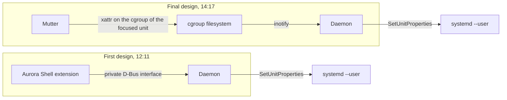

A build, an export or a video encode running in the background gets the same CPU share as the window you are typing in. On a busy machine the app in front of you can stutter while something you are not looking at finishes. KDE has `plasma-foreground-booster` for this. GNOME has nothing like it, so I wrote `gnome-foreground-booster`, a small Rust daemon that raises the systemd `CPUWeight` of the focused application and puts it back when focus moves on.

I wrote it on 10 November 2026 and redesigned it the same afternoon. The repository has 11 commits between 12:11 and 15:09, and the history shows where the design changed.

## The first design

At 12:11 the daemon received focus from Aurora Shell, my GNOME Shell extension. I added a module to the extension, `ForegroundBridge`, which exported a private D-Bus interface, `org.luminusos.AuroraShell.Foreground`. Whenever the focused window changed, the extension told the daemon which app had focus. The daemon mapped it to a systemd unit and changed its weight.

This works, and it has costs. The booster would only work for people who run Aurora Shell, and the daemon needed a private protocol with a fake implementation in GJS to test it. Two components were coupled through an interface I had invented for the occasion.

## What Mutter already publishes

Mutter already tells everyone about focus, as it turns out. Since GNOME 41, Mutter sets an extended attribute, `user.xdg.inactive-since`, on the cgroup directory of the focused window's unit. The focused unit gets `-1`. The unit that just lost focus gets a monotonic timestamp. It only writes when focus moves between different units.

That is the signal I had been building a bridge to produce. At 14:17 the commit "read focus from Mutter instead of an Aurora Shell bridge" removed the bridge, the private interface and the GJS fake.



The daemon now has no connection to GNOME Shell at all. Its only inputs are the cgroup filesystem and `/proc`. Its only output is calls to the systemd user manager over D-Bus. It works on Wayland and X11 and for any GNOME user, including people who never install my extension. The `ForegroundBridge` module still sits in the Aurora branch, but it is dead code now.

## How the booster works

It watches every slice directory under `app.slice` with inotify. On each attribute change it reads `user.xdg.inactive-since` again and keeps at most one focused unit. If more than one unit says `-1` at startup, it trusts none and waits for the next change.

A cgroup v2 `cpu.weight` only competes between siblings. Boosting a leaf deep in the tree would compare it to nothing. So the daemon boosts the direct child of `app.slice` on the path to the focused unit, which is where one app competes against another. The default weight is 400 against the systemd default of 100.

A few details came from thinking about what could go wrong:

- A 150 ms debounce, so a quick Alt+Tab sequence costs one boost at the end instead of several.
- It restores the previous weight only if the unit still has the boost weight, so it never undoes a change someone else made.
- The active boost is written to a state file under the runtime directory, so a daemon that dies in the middle of a boost can undo it on the next start.
- The weight is a runtime property, so systemd drops it when the unit disappears.

## The second bug class

At 14:57 I found a problem that the Mutter signal does not solve. GNOME Shell launches an app and then asks systemd, asynchronously, to move it into its own `app-gnome-*.scope`. An AppImage starts the real program right away. If it forks during that gap, the real process stays in `org.gnome.Shell@*.service`, and Mutter attributes its window to the Shell. I saw it with the Ghostty AppImage. The daemon must never boost the Shell's own unit.

The fix is a rescue step. When a new unit appears under `app.slice`, the daemon reads the Shell's `cgroup.procs`, selects processes whose parent lives in an app unit, adds their descendants that are still in the Shell's cgroup, and moves the group into a transient scope with `StartTransientUnit`. It runs in passes at 50, 300, 1000 and 3000 ms after the new unit appears, because the Shell moves the launcher only after the scope's cgroup exists and the stranded children may still fork. The Shell's own children, such as Xwayland and the image loaders, have the Shell as parent and are never selected.

There is one limit I could not remove. Mutter caches the unit of a window the first time it needs it. A window mapped before the rescue keeps pointing at the Shell's unit until it is closed and opened again.

I also fixed a small one on the same afternoon. By default zbus requests a bus name with replacement allowed, so a second instance of the daemon silently stole the name from the first. It now requests the name with `DoNotQueue` and exits if it is taken.

## What it does not do

Terminals boost themselves, not your commands. Ptyxis and other VTE-based terminals start each shell in its own `*-spawn-*.scope`, which is a sibling of the terminal's unit. A build started from a focused terminal does not get the extra weight. I documented that limit in the README.

I have no benchmark for this. The README says the daemon uses about 5 MB of memory and no CPU while idle. It does not say that the focused app gets faster, and I will not say it here until I have measured it. The daemon is also not in the LuminusOS image yet.

## Tests

The decision logic does not touch D-Bus. `Booster` and the rescue planner talk to systemd through two small traits, `UnitControl` and `ScopeControl`, so the unit tests run against fakes.

The end-to-end script, `tests/e2e/run.sh`, does the real thing. It starts throwaway units in a private slice, sets `user.xdg.inactive-since` on them the way Mutter does, imitates the launch race with a fake Shell unit, and runs the real daemon against the real `systemd --user`. It never touches running applications, and it refuses to start while another instance of the daemon is running. The README reports it as green.

With debug logging on, every focus switch prints a line like this:

```
boosted unit=app-flatpak-org.mozilla.firefox-270084972.scope weight=400
```

Reading the weight directly shows the same thing:

```
systemctl --user show app-flatpak-org.mozilla.firefox-270084972.scope -p CPUWeight --value
```

It prints `400` while the app has focus and `[not set]` after it loses it. The next step is putting the daemon in the image and measuring on a loaded machine what a focused app actually gains.
