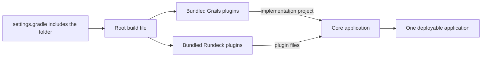
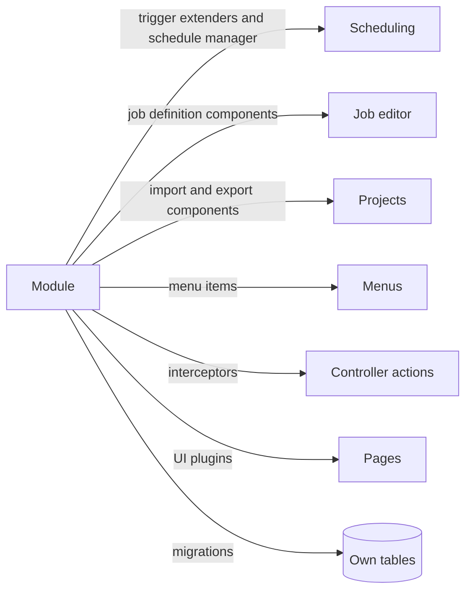

QWControl is a commercial workload automation platform from QW Software, built on top of Rundeck and sold in the same market as Control-M. I worked on it from March 2022 to November 2024. Every feature the company added to it used to live inside the Rundeck code. I led the work that moved those features out, mostly between late 2023 and 2024, and the folder where they ended up is called `qwcontrolapp`.

I will keep this post away from internals, because the code belongs to the company. The decisions are mine to talk about, though.

## What it looked like before

One codebase held everything: the core engine, the web interface, the calendar, monitoring, licensing, the VMware screens, the node editor and the docs. Features shared the same build and the same release. A change to the calendar sat in the same tree as a change to the VMware dashboard, and neither could be built or tested without the other.

That setup is fine for a product with three features. QWControl had many more.

## What I wanted

A feature should have a home. It should have its own folder, its own build file and its own tests, and the core application should load it when it starts. If a feature is missing, the rest of the product should still run.

Grails already has the right mechanism for that, which is the plugin. Rundeck also has a plugin model for job steps, so there were two kinds of pieces to separate:

- modules for platform features, such as the interface, the calendar, licensing and monitoring;
- plugins for job steps and strategies, such as SAP, NetBackup, SQL scripts and file transfer.

## How I did it

I did it in small moves, one module at a time. The calendar was first and came with its own pull request in October 2023. Monitoring, interactive node, resource manager, license, UI enhancements and rule flow followed in the next weeks.

On 24 November I changed the build so that every module is declared in one list of bundled plugins in the main build file. Three days later a single commit moved the remaining files into `qwcontrolapp/`. After that, adding a module meant creating a folder and adding a line to that list.

The interface took its own pass. In 2024 I moved the frontends of monitoring and the node editor into one package, `spa-ui`, with a folder per screen. The monitoring page, the VMware dashboard and the rule flow editor now share the same base and the same look.

## The build and the hooks

The build is the part that makes the rest possible. The main build file has two lists, one for Grails modules and one for Rundeck plugins. The application project turns every entry of the first list into a dependency and packages the second as plugin files. A module that is commented out of the settings and of the list simply leaves the product.

At runtime a module attaches to the core through extension points that Rundeck already has, so the core never imports it. The calendar, for example, extends how triggers are built, the license module toggles features that other modules read, and the interface modules inject scripts into pages by path.

## What changed afterwards

The VMware work in 2024 was a good test. It started as a plugin, then grew into a dashboard, an hourly metrics job and reports, and it became its own module with its own license check.

The license module can now decide, feature by feature, what an installation may use. A change to the monitoring page no longer shares a tree with a calendar change. Adding z/OS support to file transfer touched only the file transfer plugin.

You can see the results in the [VM Dashboard Monitor](/work/vm-monitor-dashboard/), the [Rule Flow editor](/work/qwcontrol-rule-flow-editor/), [Daily Job Monitoring](/work/qwcontrol-job-monitoring/), the [integration plugins](/work/qwcontrol-integration-plugins/) and the [platform modules](/work/qwcontrol-platform-modules/).

## What stayed with me

The build file mattered most. Once it could load a module from a folder, moving each feature became a mechanical step, and the remaining question was where each piece belonged.
