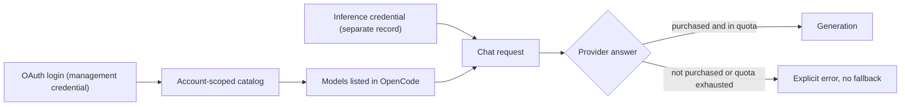

I wrote two plugins for OpenCode that connect it to model providers I use: one for QwenCloud and one for JetBrains Junie. Both are unofficial. They talk to endpoints that the vendors did not document for this use, so I will not describe those endpoints here. This post is about the design, because that is where I learned something.

The first lesson came early. After a successful OAuth login I had a connected account, a catalog of 186 model entries on the QwenCloud side, and a plugin that looked finished. Then a chat request came back with "model not purchased", and another with "monthly quota exhausted". The provider received my request and refused it. I never got a completed generation out of either plugin, and the READMEs say so.

## Three kinds of logged in

A login proves who you are. A catalog proves what the provider lists for your account. Entitlement proves that you can actually run a request now, and only the provider's answer to a real request shows that. A plugin that treats the first as the last will show models in the picker that fail when selected.

The management login and the inference credential live in separate OpenCode credential records. A listed model is not treated as proof that the account may use it, and an unrecognised quota response is never turned into a zero balance. The plugin also never reads the vendor CLI's private login files and never creates keys on your behalf. Each tool stays responsible for its own credentials.

## The wrong service

My first version of the QwenCloud plugin integrated with the wrong product. QwenCloud and Qwen Code are different services. I caught it by reading the official CLI's source and replaced the whole integration in a single commit. Since then every protocol claim in the Junie repository has an entry in a provenance document, with a source URL pinned to a commit of the official CLI, a date, and a note on what I did not do (no inference called, no key created, no polling approved). Query values count as secrets and complete URLs never go into error messages.

## A cache that cannot leak across accounts

Both plugins cache the model catalog. The cache is partitioned by connection, routing and schema, so a snapshot made under one account cannot be published under another. Switching account invalidates what OpenCode already has listed. The code checks the account both before and after every async call, which stops a slow response from the old account from landing in the new one. When access to something is revoked, a tombstone keeps that metadata from coming back after a reload.

On the Junie side, the gateway advertises 60 model IDs for my account, and 36 of them match the catalog embedded in the Junie client I checked against. Only those 36 are published to OpenCode, as 36 models with 159 variants. The plugin also checks local storage every 15 seconds so that other OpenCode locations stay in sync, and it marks a snapshot stale after 24 hours.

## Quota that can say it does not know

Quota data arrives partially, late, or in a shape the plugin does not recognise, and the easy handling is to show 0. A zero reads as "nothing left", which is a claim. So each plugin separates disconnected, unknown, partial, failed, absent and available. Errors and missing values never turn into zero or "not subscribed", and a real zero is kept as a zero (the code checks for presence, not truthiness). Other units get the same care: credits are not raw tokens, a team aggregate is not an individual allocation, and an expiry date is not a reset date.

## Hardening the request

The final request goes through a narrow gate. It accepts one pinned POST path, to a fixed destination. The model in the body must exist in the active catalog. Upstream headers are replaced with the plugin's own, redirects are refused, retries are off, and there is no automatic fallback to pay-as-you-go or to another account. A fallback that spends money without being asked is a bad surprise, so any switch has to be an explicit user choice.

While testing the Junie plugin I also found a gap in how the host passes requests along, and it weakens the redirect guarantee. I am leaving the details out of this post. The plugin's README warns against running real inference until the host is corrected.

Timeouts are part of the same design. The deadline is enforced before the response headers arrive and throughout the streaming body, and the timer and controller belong to the scope of the request, so cancelling the request cancels the reader too. The request keeps strong references to them, and a regression test forces garbage collection to check that the deadline still fires.

## A loopback adapter with its own key

OpenCode has a quota plugin that can read from a local HTTP source. I exposed the Junie quota through a small adapter that listens only on 127.0.0.1, answers only `GET /quota`, and returns the quota-v1 format that plugin understands. It has a third credential, independent from the other two, and rejects query strings, the wrong Host header, any browser Origin and duplicate Authorization headers. Connections, payload sizes and time are bounded. I run it as a transient user-level systemd unit, which does not survive a reboot, and the docs say that.

The adapter caused my best debugging story. The panel kept saying the custom provider was not set up. The cause was that the adapter key was missing from the environment of the OpenCode server process. Setting it on my repair process failed, because another client had won the race to start the service with its old environment. The fix was to store the key in the server's private environment configuration and restart it.

## Writing down the failures

Each repository records its limits next to its claims: live checks returned purchase and quota errors, and no completed generation. On the QwenCloud side I verified login and the catalog live, and chat reached the provider and was refused. The two repositories have around 77 test cases (QwenCloud) and 74 (Junie), and those exercise the plugins' own behavior with synthetic credentials. They cannot tell you whether a provider will accept a request from a particular account.

What is still open: a successful end-to-end generation on a paid plan with either provider, and the host-side issue I mentioned. The QwenCloud plugin is still local, and the Junie one is public and has no license file.
