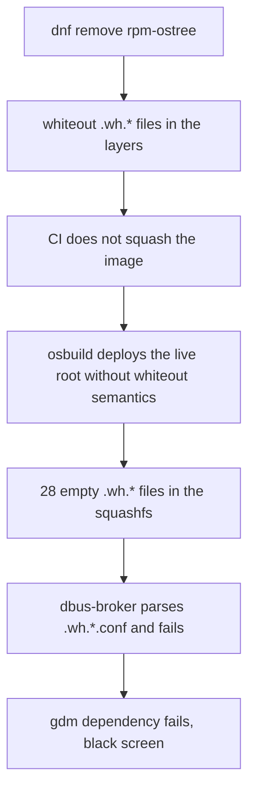

LuminusOS is an immutable GNOME desktop that I build as a bootc image from a Containerfile. One day the ISO that CI produced booted into the Plymouth splash and then stayed on a black screen forever. The CI boot test said the same thing in its own way: "Final screendump has 1 distinct sampled colors".

The qcow2 disk image built from the same workstation image booted fine. Same build, two outputs, only one of them broken.

## How the boot test sees a black screen

The smoke test is a bash script that boots the ISO or the qcow2 headless in QEMU with UEFI. Every 30 seconds it asks QEMU over QMP for a screendump, up to 420 seconds for the ISO. Then it counts the distinct colors in the last screenshot. A black screen has one, a text console has fewer than 32, and a rendered GNOME surface has hundreds. The threshold is 64. OCR runs too, but only as advisory output.

It is a crude check, and I like it because it does not depend on what is drawn on the screen, only on whether anything is drawn at all.

## Reading the serial console

A screenshot of black tells you nothing, so I booted the ISO locally with a serial console. The useful lines were these:

```
dbus-broker-launch: Invalid XML in /usr/share/dbus-1/system.d/.wh.org.projectatomic.rpmostree1.conf
Failed to start dbus-broker.service
DEPEND Dependency failed for gdm.service
```

dbus-broker reads every file in `system.d` as a bus policy. One of them was an empty file called `.wh.org.projectatomic.rpmostree1.conf`, which is not valid XML, so the system bus never started. GDM depends on it, so the display manager never came up.

## What a whiteout is

An OCI image is a stack of layers. A layer cannot delete a file from a layer below it. To hide a file, it writes an empty marker named `.wh.<filename>`, a whiteout. Tools that apply layers, such as Podman, Docker and the kernel's overlayfs, read the marker and hide the file.

My Containerfiles used to remove `rpm-ostree` from the image with `dnf remove`. Each removed file left a whiteout in an upper layer. The live root of the ISO is built by osbuild, and osbuild deployed that image without applying whiteout semantics. The markers turned into real, empty files in the squashfs. There were 28 of them. The qcow2 goes through the ostree and bootc deploy path, which does honor whiteouts, and that is why it worked.



Nothing in the chain is wrong on its own terms. The OCI spec does not oblige a consumer to apply whiteouts the way overlayfs does, and I was the one feeding it an image that depended on them.

## Fixing it in layers

The first fix was to revert the removal. Dropping `rpm-ostree` from an image that is managed by ostree was a bad idea anyway, and it was the source of the markers.

The next attempts were about squashing. I tried `--squash-all` in the build, and then a `buildah commit --squash` after the build so I could keep the layer cache. A squash applies the whiteouts and leaves one layer with the final filesystem.

What I kept is a structural guard in `Containerfile.installer`, the Containerfile for the live root. The last stage is:

```dockerfile
FROM scratch
COPY --from=live / /
```

That copies the merged filesystem into one fresh layer, so no `rm` in any earlier stage can leak a whiteout. A build-time check backs it up: the verification `RUN` step fails the build if `find` locates any file named `.wh.*`.

The lesson I wrote down is that a consumer of an OCI image does not have to honor whiteouts. If a third-party tool will copy the filesystem out of the image, ship it without any.

## The second failure had nothing to do with the build

After the fix the boot test still failed. This time the screenshots showed the Sirius installer perfectly up to the 330 second mark and black from 360 seconds on.

The build was fine. GNOME's default `idle-delay` is 300 seconds, and the test VM never moves the mouse. About 60 seconds of boot plus 300 seconds of idle gives a black screen in the final screendump at 420 seconds. The screen was blanking, as designed.

I fixed it in the dconf defaults that exist only on the live ISO: `idle-delay=0`, no dimming, no suspend, no screensaver. I treat this as a product rule more than a test fix. An installer should never hide itself from the person using it. A headless test environment is just the place where defaults made for a user sitting at the machine show up first.

## The third one: a tag that was not written

Later, installing from the ISO failed with this error:

```
no descriptor found for reference "latest"
```

The ISO carries the system payload as an OCI layout directory, and `bootc install` reads it by reference. I had exported the payload with skopeo to a destination without a tag, `oci:.test/payload.oci`. In that case skopeo does not write the `org.opencontainers.image.ref.name` annotation into `index.json`. The installer looked for a descriptor annotated `latest` and found none.

The destination has to be `oci:.test/payload.oci:latest`. Skopeo strips the tag from the directory name on disk and records it as the annotation. The Containerfile now checks it with `jq`, so a missing annotation fails the build instead of the install:

```
jq -e '.manifests[0].annotations."org.opencontainers.image.ref.name" == "latest"'
```

The local Just recipes and the CI workflow also use the same packaging script now, so the two paths cannot drift in how they export the layout.

## What I check first next time

When an ISO and a disk image from the same source disagree, I look at how each one is deployed before I look at the content. They can read the same OCI image and apply different rules to it. I also read the serial console before anything else, because a black screen is a symptom with a very large number of causes and a log line has one.

The release pipeline for LuminusOS is still moving. The testing channel publishes daily, and the first stable release waits for Fedora 45 to ship.
