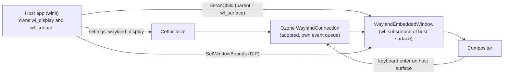

CEF has had `SetAsChild` for years. On X11 you give it the ID of a window, and the browser shows up inside your window. On Wayland the same call can leave a stray window floating on the screen, return success without drawing anything, or crash the process. The upstream issue for this (chromiumembedded/cef#2804, "Linux: Add support for embedded Ozone/Wayland windows") was opened in 2019 and is still open.

I spent part of this year on it. I opened pull request #4233 against CEF, and it is still open and not merged. This post is about why the problem exists and what a fix looks like. I wrote the patch with heavy help from Claude Code, the commits carry an `Assisted-by: Claude Code` trailer as CEF's AI policy asks, and I take responsibility for all of it.

## Three ways to embed CEF

CEF has three ways to show a browser inside an application on Linux. Views gives you a CEF-owned top-level window and has worked on Wayland for a few years. Off-screen rendering (OSR) hands you pixel buffers and lets you draw them yourself, and it has worked for a long time (Spotify uses it). The third is native windowed mode, where the host passes a parent handle through `SetAsChild` and CEF creates a child window inside it. Only the third is missing on Wayland, and it is the only thing issue #2804 is about.

## An X11 window ID is global, a wl_surface is not

On X11, a `Window` is a 32-bit ID that belongs to the X server. Any client can use it. CEF opens its own connection to the server, and `x11::Connection::CreateWindow()` takes the parent as a plain integer, so the new window can live inside a window that another connection created.

A `wl_surface` is a protocol object. It exists only inside the `wl_display` connection that created it, and `wl_subcompositor_get_subsurface()` requires the parent and the child to be on the same connection. A browser process that opens its own Wayland connection has no way to refer to the host's surface. Every other difficulty in this problem comes from that rule.

## What CEF does today

I wrote a small Rust host app to see the failures (it is a separate project, `cef-wayland-embed-sample`). Here is what the same `SetAsChild` call produces on Fedora 44 with GNOME 49:

| Scenario | Result |
|---|---|
| `windowed-x11` (control) | A child window inside the panel. Its XID is in a different range than the host's (`0x1c00004` against `0x2a00004`), which shows it came from another connection. |
| `windowed-wayland` | A detached XWayland window floats over the host. Release builds of `libcef.so` still have the X11 backend compiled in, and `parent_window` arrives as 0. |
| `windowed-wayland --no-xwayland` | `CreateHostWindow()` returns `true`, `GetHostWindowHandle()` returns `0xffffffff`, and the panel stays empty. |
| `osr` | Works: 39 `OnPaint` calls in 12 seconds at 1224x582. |
| `views` | Works, in a separate top-level window. |

Both Wayland windowed cases end with a `SIGSEGV` in `WaylandWindowManager::GetWindow` when the first event is dispatched, because the XID is used as a `gfx::AcceleratedWidget`.

These symptoms resemble what people report for Steam on Wayland: blank windows and dead menus. Whether Steam actually uses this embedding mode is a guess from the symptoms, and I have not verified it. I did check one popular theory, that the May 2026 ANGLE Wayland merge would fix this. The CEF maintainer said in June it would not, and the embedding runs on a Chromium checkout whose ANGLE has only the older Vulkan Wayland path. The GPU process never touches Wayland: it renders into dmabuf buffers and the browser process presents them.

## Sharing the connection

The approach I implemented has the host hand its `wl_display` to Chromium, and Chromium adopts it instead of opening a new one. Chromium's `WaylandConnection` already creates a dedicated event queue and wraps the display in a proxy, so that it does not flush messages belonging to other users of the connection. Two dispatchers on one connection turned out to be a smaller problem than I feared. The adoption has to be process-wide, because Ozone initializes inside `CefInitialize`, before any `CefWindowInfo` exists. A 2020 prototype from Igalia put the display on `CefWindowInfo`, which cannot work.

The browser window becomes a new `WaylandEmbeddedWindow`, a `wl_subsurface` of the host surface, registered in `WaylandWindowManager` so that widget lookups work. I did not need a Wayland twin of `CefWindowX11`, a 539-line class, because on Wayland the embedded window is the platform window of the views host. Views only understands a native parent as a `gfx::AcceleratedWidget` and already forwards it to Ozone, so registering the client's surface produces one and nothing in views changes.

One trap: views maps `TYPE_CONTROL`, which an embedded browser uses, to a popup window type, so the foreign-parent check has to run before the type switch in `WaylandWindow::Create()`.

## What came for free, and what did not

A subsurface never receives `wl_keyboard.enter`, and the issue thread had concluded embedders must forward every key. They do not. Chromium already receives those events on the shared connection and dropped them, because it could not resolve the host's toplevel. Teaching that lookup about registered foreign surfaces routes keyboard focus with no embedder code.

The same lookup hid a memory-safety bug. It cast the user data of any `wl_surface` to a Chromium pointer, and on a shared connection that data belongs to the host toolkit (GTK and Qt both set it). I reproduced it as a crash by moving the mouse over winit's client-side window borders. The fix tags Chromium's own surfaces with `wl_proxy_set_tag()` and resolves only tagged ones. Drag and drop then attributes correctly with no equivalent of `XdndProxy`, because each side answers only for its own surfaces.

Popups were harder. An `xdg_popup` needs an `xdg_surface` parent and a subsurface has none. The host can pass its own `xdg_surface` in an optional field, since both share a process and a connection. Without it, CEF falls back to a degraded subsurface that clips at the window edge and has no grab.

Geometry also changes. A subsurface gets no `configure` event, so the host has to push bounds through a new `CefBrowserHost::SetWindowBounds()`. Those bounds are in DIPs, since `wl_subsurface.set_position` is surface-local. My Rust host passed physical pixels at first, which looks right at scale 1.0 and puts the browser off screen on a 1.25 monitor.

## What the maintainer said

After I wrote the design above, the CEF maintainer reviewed the pull request on October 20 and reversed several choices. The one that matters for this post: I had made `parent_window` carry the `wl_surface` pointer. A valid XID and an address look the same, so a wrong handle is undefined behavior and not an error CEF can report. He asked for a separate Wayland parent field, with `parent_window` kept for X11. He also wants the display in `CefSettings` instead of a setter, a Wayland path in `cefclient` instead of my standalone sample, and evidence on KWin as well as Mutter. I am splitting the work into a smaller series that starts with the settings change.

## What I could and could not verify

Everything above ran on Fedora 44 with GNOME 49 (Mutter), on two monitors with different scales. IME works with ibus and Intelligent Pinyin: preedit text, a candidate window by the caret, and commit. I have not built on macOS, I have not tested another compositor, and I have not watched CJK composition over a long session or a scale change while a popup is open. Resize also lags the host by one frame, because the subsurface position is double-buffered on the parent, and the same TODO exists upstream.

Someone has reported that popup menus land in the wrong place on Plasma 6.7.3. I do not have a KDE setup yet, and that is the next thing the maintainer asked me to prove.
