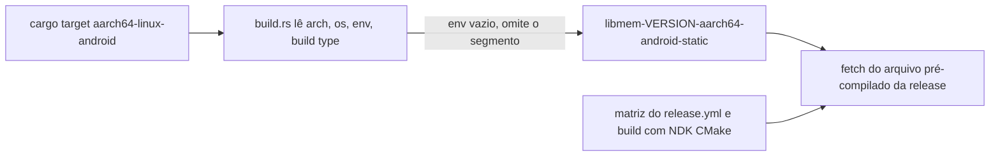

O libmem é uma biblioteca em C e C++ do rdbo para trabalhar com memória de processos, com bindings para Rust e Python, sob AGPL-3.0. Eu precisava dela num projeto que mistura Rust e Kotlin no Android, e o libmem não tinha target para Android. Então adicionei um. O pull request (rdbo/libmem#302, "Add CI and build support for Android") foi aberto em 20 de julho e mergeado pelo dono em 30 de agosto. Tem dois commits e mexe em quatro arquivos, com 138 linhas adicionadas e 4 removidas.

Este post cobre o lado da cross-compilação: o que o crate `-sys` do Rust assume sobre o target, o bug que encontrei primeiro e o que o CI que adicionei prova e o que ele não prova.

## O que o libmem-sys assume sobre o target

O crate `libmem-sys` tem uma feature `fetch`. O `build.rs` dele lê a configuração de target do Cargo, monta o nome de um arquivo pré-compilado e baixa esse arquivo da release do projeto no GitHub. O nome é formado por versão, arquitetura, SO, uma string de ambiente e o tipo de build, por exemplo `libmem-<version>-x86_64-linux-musl-static`. No Linux com a feature `static`, o script até força o ambiente para `musl`, para que todo build estático de Linux caia num único arquivo.

O Android não tem esse override. O nome é montado com o que o Cargo informar para o target.

## O target_env vazio

Em `aarch64-linux-android`, `CARGO_CFG_TARGET_ENV` é uma string vazia. A string de formato não se importava, então o nome saía com dois hífens seguidos: `libmem-<version>-aarch64-android--static`. Esse arquivo não existe na página de releases, então o passo de `fetch` pedia uma URL que nunca poderia resolver.

A correção é uma condição que omite o segmento quando ele está vazio:

```rust
let release_target = if target_env.is_empty() {
    format!("libmem-{}-{}-{}-{}", version, target_arch, target_os, build_type)
} else {
    format!("libmem-{}-{}-{}-{}-{}", version, target_arch, target_os, target_env, build_type)
};
```

O crate já tinha um teste unitário para esses nomes. Adicionei um caso que recebe `["1337", "android", "aarch64", "", ""]` e espera `libmem-1337-aarch64-android-static`. Agora uma regressão no nome quebra um teste unitário, e antes ela aparecia como um download falhando no build de outra pessoa.



## Bibliotecas de link

O Linux linka `dl`, `m` e `stdc++`. O ramo do Android linka `dl`, `m` e `c++_shared`, porque compilo o libmem contra o runtime C++ compartilhado do NDK. Isso tem uma consequência para o app que usa a biblioteca: o `libc++_shared.so` precisa ser empacotado no APK junto com a biblioteca Rust.

## Compilando com o toolchain do NDK

O script de release `tools/build-release.sh` ganhou uma função `_build_android`. Ela se recusa a rodar se `ANDROID_NDK_ROOT` não apontar para um NDK instalado. A configuração de CMake para Android recebe o toolchain file do NDK, `ANDROID_ABI=arm64-v8a`, `ANDROID_PLATFORM=android-26`, `ANDROID_STL=c++_shared` e código independente de posição. O script deriva o ABI do nome do target e sai com erro para qualquer coisa que não reconheça, o que hoje significa tudo menos `aarch64`.

No `release.yml` a matriz de build tem uma entrada nova, `aarch64-android-static`. Só para essa entrada, o job instala Java 17 e o Android SDK com `android-actions/setup-android@v3`, depois NDK `27.0.12077973` e CMake `3.22.1` via `sdkmanager`. Os outros targets rodam como antes, porque cada um desses passos é condicional ao nome do target conter `-android-`.

## O que o CI prova e o que ele não prova

Adicionei um segundo workflow, `rust-android-test.yml`. Ele compila a biblioteca estática com o toolchain do NDK, entra em `bindings/rust` e roda `cargo test --no-run --target aarch64-linux-android` usando o clang do NDK como linker. Isso compila os bindings e linka o binário de teste contra a biblioteca. Não executa nada, porque um runner do GitHub não tem dispositivo Android. O workflow também é só manual (`workflow_dispatch`), então não roda a cada push.

Uma execução verde diz que os símbolos resolvem e que a linha de link está correta. Não diz nada sobre o comportamento num dispositivo. Verifiquei isso à mão num hardware com Android 16, e essa checagem não faz parte do repositório.

## A revisão no upstream

O pull request ficou 41 dias entre a abertura e o merge. O diff fica dentro do que já existia: o script existente, a matriz de release existente e o teste unitário existente. O target novo fica ao lado dos antigos, com a mesma nomenclatura. Quatro arquivos com um motivo cada facilitaram a leitura do dono, e acho que isso pesou mais no resultado do que qualquer coisa esperta na mudança.

O `master` do meu fork ainda não tem o commit de merge, porque o fork está atrás do upstream e eu não o sincronizei.

## O que ainda está em aberto

Só existe `aarch64-android`. Uma imagem de emulador x86_64 precisaria de outro ABI no script e de outra entrada na matriz. O teste de link não pega problemas de runtime, então qualquer mudança futura nesse caminho precisa de uma rodada num celular de verdade, e eu só fiz isso em um dispositivo. O workflow de link também poderia rodar em pull requests em vez de sob demanda, o que pegaria uma linha de link quebrada mais cedo. Não propus essa mudança.
