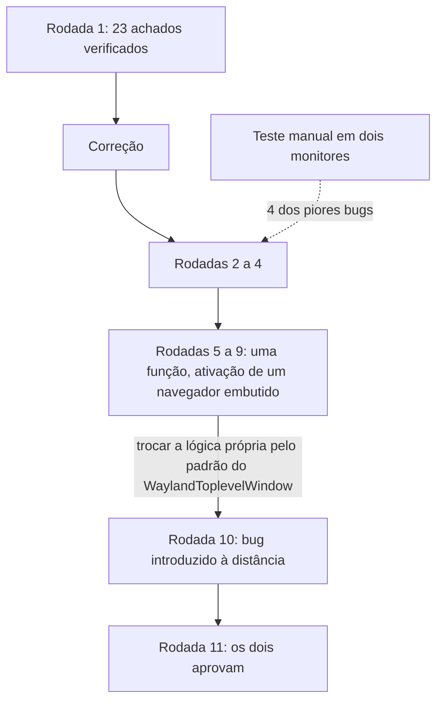

Escrevi meu patch de embedding Wayland para o CEF com bastante ajuda do Claude Code. Os commits dizem isso num trailer `Assisted-by: Claude Code`, porque a política de IA do CEF exige, e eu assumo a responsabilidade pelo que está neles. Fiz a branch ser revisada por dois outros revisores de IA (Codex e Kimi, como aparecem nas minhas anotações) e somei meus próprios testes manuais. Foram 11 rodadas. Mantive um log de achados de 1.155 linhas, e este post é o que está nele.

O pull request (chromiumembedded/cef#4233) continua aberto e sem merge. O mantenedor revisou em 20 de outubro e pediu mudanças de design, então parte do código que endureci aqui vai ser reescrita. Volto a isso no final.

## O cenário

A branch tem cinco commits: o patch do Chromium para o Ozone, a API do CEF e a seleção de plataforma em runtime, navegadores em janela no Wayland, um sample e notas de design. Cada rodada gerou achados, e o log marca cada um como verificado ou como falso positivo.

Nas 11 rodadas, o log conta 45 achados verificados e 7 falsos positivos. Só a rodada 1 teve 23 achados verificados: 5 blockers, 8 major e 10 minor. Os blockers eram um build quebrado no macOS, um close que nunca termina, o foco de teclado que não alterna entre dois navegadores, um `parent_xdg_surface` nulo que derruba o processo e uma leitura fora dos limites quando o chamador usa a API Stable.

Na rodada 1, o Codex teve 4 falsos positivos, todos o mesmo erro: leu linhas de contexto do diff como espaço em branco no fim da linha. O Kimi teve 3. O Kimi também deu sete rodadas de LGTM, e a conclusão do meu log é que a contagem de LGTM mede o quão alto o revisor põe o próprio limite, o que diz pouco sobre o código. Nenhum dos revisores substituiu o outro, e nenhum substituiu rodar o código. Um deles nunca atualizava o estado entre as rodadas e repetiu quatro vezes um falso positivo já refutado. O outro parava de procurar cedo, embora uma vez tenha retratado um achado por escrito.

## O que a revisão estática achou e o que só o clique achou

Os revisores acharam o que uma leitura cuidadosa de um diff consegue achar: ownership errado, uma checagem de nulo faltando, um erro de build numa plataforma em que não consigo compilar. Quatro dos piores defeitos vieram de mim clicando, arrastando e movendo a janela entre os meus dois monitores. Eles vivem num comportamento que só existe quando as coisas se movem: um navegador com offset, dois navegadores, uma janela que cruza para uma tela de escala diferente. Quase tudo que quebrou era algo que um único navegador em (0,0) cobrindo a janela inteira nunca exercita.

## A função que levou cinco rodadas

A ativação de um navegador embutido, ou seja, como ele recebe o foco de teclado, passou por cinco rodadas seguidas. Cada correção expunha o defeito seguinte na mesma função. Eu estava escrevendo lógica própria para algo que o Chromium já resolve para as próprias janelas. Só convergiu quando eu parei e copiei o que o `WaylandToplevelWindow` faz: derivar o estado do seat, notificar pelo caminho do window manager e adiar a ação, em vez de adiar a notificação.

Um patch que precisa explicar por que difere do upstream provavelmente está errado. Eu deveria ter procurado o mecanismo equivalente já na primeira daquelas cinco rodadas.

Também cometi um erro do mesmo tipo nas minhas próprias correções. Uma primeira "degradação graciosa" para um `xdg_surface` nulo abortou o processo do mesmo jeito que o ponteiro nulo. E uma correção ficou pela metade: um caso especial ficou num helper compartilhado por dois caminhos de código que usavam espaços de coordenadas diferentes, um `xdg_popup` ancorado na surface do host e um subsurface de bolha do navegador embutido. Ele era inofensivo até o fallback de bolha existir.

## O bug que nenhum diff continha

Na rodada 10, uma mudança correta num arquivo fez duas chamadas inertes em outro arquivo se tornarem destrutivas. Nenhuma linha do segundo arquivo mudou. Um review baseado em diff, seja Gerrit, GitHub ou uma IA lendo um patch, não enxerga isso, porque o código quebrado não está no diff. Uma anotação de um revisor no log diz que aquela função tinha sido lida por três ou quatro rodadas sem que o problema fosse percebido.

Desde então, sempre que mudo um helper compartilhado, leio os outros chamadores dele, mesmo que os arquivos deles não estejam no diff.

## Testes que passam pelo motivo errado

Cobertura falsa apareceu seis vezes, de três formas. Um teste passou porque não havia teclado conectado, então a ativação caiu num nível diferente do que eu queria testar. Um teste afirmou um estado intermediário quando deveria afirmar o que um observador vê. E um esvaziou a fila de eventos exatamente no ponto onde a race vive.

Terminei com 34 testes automatizados, 30 no harness `WaylandTest` do Ozone e 4 no ABI do `cef_window_info_t`. Verifiquei cada um reintroduzindo o bug que ele cobre e conferindo que falha. A suíte do Chromium com 476 testes de Wayland continua passando. Para dar proporção, o log anota que nenhum dos 116 patches do Chromium que o CEF carrega tem testes e nenhum adiciona um arquivo novo.

Um dos testes de ABI achou um bug real. O `CefStructBase::Set()` chama `Clear()` para limpar membros mais novos, mas o `clear()` dos traits só libera strings, então um ponteiro `parent_xdg_surface` antigo sobreviveu a uma atribuição vinda de uma struct menor. O código upstream tem a mesma lacuna para membros que já existem.

Formatação também apareceu como achado. Uma primeira revisão trazia 150 linhas de ruído de formatação, e removê-las encolheu o patch de 1.243 para 1.155 linhas. A regra que fixei é rodar o `clang-format` só nos arquivos que o patch introduz.

## O checklist que mantenho agora

- Escrever o que um observador veria antes de escrever o teste, e quebrar o código de propósito para ver o teste falhar.
- Procurar o mecanismo equivalente no código que estou estendendo antes de escrever lógica própria.
- Depois de mudar um helper compartilhado, ler todos os chamadores dele, inclusive os que estão fora do diff.
- Testar com dois navegadores, um offset e dois monitores de escalas diferentes, já que um navegador na origem esconde a maioria dos bugs.
- Contar os falsos positivos de cada revisor e tratar uma sequência longa de LGTM como informação sobre o revisor.

## Onde isso está agora

O PR #4233 está aberto. A revisão do mantenedor em 20 de outubro reverteu várias escolhas de design, incluindo a forma de passar a surface pai, então parte do que essas rodadas lapidaram vai mudar. Quais dos 34 testes sobrevivem ao redesign, eu ainda não sei.
