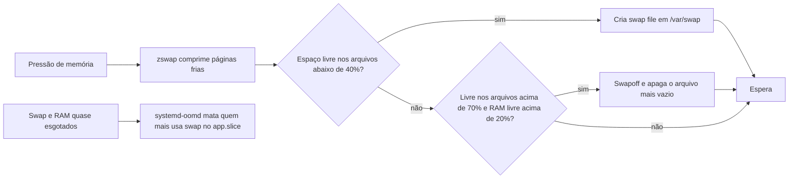

O macOS não pergunta quanto de swap você quer. Ele começa pequeno e cresce o swap quando a memória aperta. Num desktop Linux típico o tamanho é decidido uma vez, na instalação ou por um generator, e fica assim. Para o LuminusOS eu queria o comportamento do macOS: comprimir as páginas frias na RAM primeiro, e só ir para o disco quando isso não bastar, com a parte em disco crescendo e encolhendo sozinha.

Este post é sobre o elastic-swap, o daemon que acabei usando. É um fork, e a maior parte do que mudei existe porque o filesystem root é somente leitura.

## De onde partiu

Minha primeira versão foi um serviço provisório, o `luminusos-swapfile.service`. Ele criava um `/var/swap/swapfile` fixo em Btrfs, com metade da RAM, entre 2 e 16 GiB, e a imagem ligava o zswap com zstd. Funcionava, mas o tamanho vinha da quantidade de RAM e não de quanto swap alguém precisava.

Escrever um controlador de swap files do zero é o tipo de trabalho que parece curto e não é. A parte difícil é decidir quando criar um arquivo e quando remover outro sem causar uma tempestade de operações de swapoff, e esses limites precisam ser medidos. Alguém já tinha feito. O biglinux-systemd-swap é uma reescrita ativa em Rust do systemd-swap em Python do Nefelim4ag, com um controlador de cerca de 1.300 linhas e os invariantes documentados. Os dois são GPL-3.0, então fiz o fork, mantive a atribuição e chamei o meu de elastic-swap. Hoje são umas 8.000 linhas de Rust, na versão 0.2.4.

O nome colide com um projeto de DeFi sem relação, que foi explorado em dezembro de 2021, então pesquisar por ele na web é uma bagunça. Decidi manter o nome mesmo assim e documentar o problema. Também evitei o nome original `systemd-swap`, porque o Fedora tem um pacote com esse nome e ele conflitaria em `/usr/bin`.

## O modelo

O modo padrão é zswap mais swap files. O zswap do kernel comprime as páginas frias num pool limitado a 45% da RAM. Quando o pool enche, o shrinker escreve as páginas comprimidas em swap files em `/var/swap`. O zswap precisa de um dispositivo em disco para escrever, então nesse modo os arquivos não são opcionais. A imagem também define `vm.swappiness=100`, `vm.watermark_boost_factor=0` e os argumentos de kernel `zswap.enabled=1 zswap.compressor=zstd`.

O daemon verifica a cada segundo enquanto existirem swap files. Ele cria um arquivo quando o espaço livre nos arquivos cai abaixo de 40%. Remove um quando esse espaço livre passa de 70% e a RAM livre passa de 20%. A remoção escolhe o arquivo mais vazio, e só se os demais arquivos continuarem com pelo menos 55% livre. Essa margem fica 15 pontos acima do limite de criação, para que apagar um arquivo não dispare imediatamente a criação de outro. Depois de qualquer criação ou remoção ele espera 60 segundos, ou 300 no modo zswap.

O tamanho dos arquivos cresce com a quantidade. Em Btrfs, onde a pré-alocação é barata, os 8 primeiros arquivos têm 512 MB, os 8 seguintes têm 1 GB e o resto tem 2 GB. Vinte e quatro arquivos somam 28 GB quando nenhuma outra área de swap está ativa. O limite de 24 vem do kernel: ele aceita um número fixo de áreas de swap ao mesmo tempo e recusa um `swapon` além disso com `Operation not permitted`. Foram 24 no único kernel que medi, o 7.2.11. É por isso que os arquivos ficam maiores em vez de só mais numerosos.

## O que um root somente leitura quebrou

A maioria das premissas do fork era sobre um sistema mutável normal. Quatro delas falharam no LuminusOS.

O caminho padrão do swap era `/swapfile` e a unit só permitia escrita ali. O root da imagem é somente leitura, então o caminho virou `/var/swap`.

Um helper em bash, o `pre-systemd-swap`, editava o `/etc/fstab`. A imagem não escreve no fstab, então ele saiu, e o daemon nunca toca nesse arquivo. Lendo o helper direito, vi que ele também definia o `vm.min_free_kbytes` e colocava as transparent huge pages em `madvise`. Remover o helper perderia os dois em silêncio. Agora o daemon calcula e grava o `min_free_kbytes` sozinho em Rust, e uma regra do tmpfiles define o THP.

A terceira foi a que mais me custou. O `/var/swap` deveria ser um subvolume Btrfs com copy-on-write desligado, o que evita um deadlock sob pressão de memória. Minha primeira ideia foi uma regra do `tmpfiles.d` com o tipo `v`. A man page do systemd diz que o `v` cria um subvolume só se o diretório raiz `/` for ele mesmo um subvolume, e o root de uma imagem composefs não é. Ele teria criado um diretório comum sem me avisar.

A quarta é o sandbox. Com `ProtectSystem=strict` e `ReadWritePaths`, o `/var/swap` vira um bind mount dentro do namespace do daemon. Quando o daemon tentou remover um diretório vazio que não era subvolume, o `remove_dir_all` devolveu `EBUSY` no ponto de montagem e o serviço não subiu. A correção foi uma unit oneshot separada, a `elastic-swap-prepare.service`, que cria o subvolume sem sandbox de mount antes do daemon iniciar. O daemon continua sandboxed, e a remoção dele virou um `rmdir` simples que tolera `EBUSY`.

Também decidi não tentar levar nada disso para o suporte novo a Rust do systemd. Ele é construído com Meson, aceita só programas folha e é LGPL, e o meu código é um derivado GPL-3.0 com um projeto Cargo e dependências em crates. O Fedora 45 traz o systemd 262 de qualquer forma.

## A armadilha do zram

O fork também tem um pool dinâmico de zram, que continua como um modo selecionável. A documentação do fork descreve uma falha que eu não quero ver na máquina de ninguém. Um dispositivo zram anuncia um tamanho, mas a memória por trás dele depende de quão bem os dados comprimem. Quando o pool chega ao limite de memória, as escritas no dispositivo começam a falhar. A função `should_reclaim_retry()` do kernel ainda conta como swap livre os slots que nada consegue sustentar, então o reclaim continua apontando para o mesmo dispositivo em vez de cair para os swap files.

Numa VM, um pool que anunciava razão de 3,0x encontrou dados que comprimiam 1,02x. O log encheu com 1,5 milhão de linhas `Write-error on swap-device`, os swap files ficaram com 0 bytes e a máquina travou sem nenhum OOM kill. As regras de dimensionamento do pool agora só adicionam slots que a RAM restante conseguiria sustentar se os próximos dados não comprimissem nada. O padrão que sai na imagem continua sendo zswap mais swap files, e o zram é algo que se seleciona de propósito.

## Quando o swap acaba

Swap que cresce também tem teto. Para isso adicionei um drop-in no `app.slice` do usuário com `ManagedOOMSwap=kill`, de modo que o systemd-oomd mata a aplicação que mais usa swap quando ele acaba. O GNOME Shell vive no `session.slice` e de propósito não é candidato. Prefiro perder um navegador a perder a sessão.

## Uma revisão e o que continua aberto

O daemon tem `#![deny(unsafe_code)]` e uma única chamada a `libc::swapoff`, e nunca escreve no fstab. Uma revisão feita por críticos que não escreveram o código reprovou a primeira rodada em correção, segurança e licença. Dois dos achados foram um `remove_dir_all` num caminho alcançável por um symlink em corrida e uma denylist de strings que `..` e `//` contornavam. A segunda rodada passou, e os testes foram de 173 para 187.

O RPM vai na imagem workstation, fixado por versão e checksum. O que não terminei é a validação em que eu confiaria numa máquina que me importa. Um teste de estresse em hardware real e uma execução com SELinux em enforcing ainda estavam abertos quando escrevi as últimas notas. Até isso ser feito, considero o conjunto não comprovado em hardware real.
