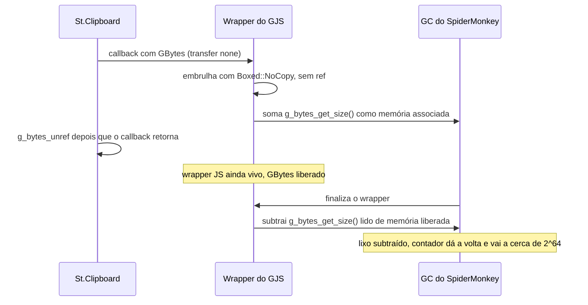

O Aurora Shell é a extensão do GNOME Shell que eu escrevo para o LuminusOS. Em setembro eu estava portando ela para o GNOME 51 quando ela começou a fazer algo que eu não sabia explicar: depois de um ou dois screenshots, o shell inteiro congelava. Corrigi a primeira causa e o congelamento sumiu, mas o shell continuou lento. As animações travavam, principalmente quando o dock aparecia. Nada resolvia, só logout.

Este post conta como descobri o motivo. Foram um perfil de GC e uma lista longa de hipóteses riscadas.

## O congelamento que era culpa minha

O congelamento total era um bug no dock. O `updateAutoHide()` fazia polling a cada 100 ms, sem fim, na prioridade padrão do main loop, enquanto uma janela bloqueava o autohide. Quando cada tick passou a levar uns 110 ms, o timer ficava sempre pronto e o redraw nunca rodava. Movi o polling para a prioridade idle e fiz ele rodar só com menu aberto. Os congelamentos pararam.

A lentidão ficou. Ou seja, havia um segundo problema, e ele se comportava como um estado que, depois de ativado, nunca desativa.

## Medindo o garbage collector

Ligar o profiler de GC do SpiderMonkey (`JS_GC_PROFILE=0`) me deu os primeiros números concretos. Uma sessão normal mostra uma coleta periódica `MEM_PRESSURE` a cada 10 segundos. Depois dos screenshots, em poucos minutos o log tinha 4.354 coletas marcadas como `TOO_MUCH_MALLOC` e 1.661 marcadas como `EAGER_ALLOC_TRIGGER`.

O perfil tem uma coluna para o contador de malloc, `MllcKB`. Numa sessão saudável ele fica em torno de 10 MB. Logo depois do segundo screenshot, na coleta periódica seguinte do GJS, ele marcava 18014169870309330 KB. Isso é cerca de 2^64. Alguém tinha subtraído mais memória associada do que alguém tinha somado, e o contador sem sinal deu a volta. Dali em diante o engine achava que havia uma quantidade enorme de memória externa alocada, e toda alocação JS disparava um GC completo. O heap JS em si ficou em uns 24 MB o tempo todo. Isso explica por que desligar módulos, ou a extensão inteira, depois do fato não mudava nada: o estrago estava no contador.

## Riscando hipóteses

Antes de confiar nisso, eu tinha uma lista do que já tinha descartado:

- Crash, OOM e erro de GPU: nada no journal, no coredumpctl nem no log do kernel.
- Deadlock no mutter ou no driver: um watchdog sondando via D-Bus mostrou o main loop vivo.
- Vazamento de handlers ou objetos JS: os heap dumps antes e depois tinham 24,5 e 24,6 MB.
- Pressão de memória no sistema: PSI em 0, 26 GB livres, nenhum sinal do LowMemoryMonitor.
- Contabilização de GdkPixbuf no GJS 1.89.2: li `gi/object.cpp` e `gjs/mem.cpp` e testei três formas de criar um pixbuf. O contador ficou balanceado.
- Reproduzir num Shell headless dentro de um toolbox: dois screenshots pela UI real e um GC forçado. O malloc ficou em uns 7,7 MB.

A última linha só me disse que um teste headless não ia me mostrar esse bug.

## O teste que isolou

O passo seguinte foi desligar um módulo antes dos screenshots, em vez de depois. Desligar as coisas depois que a lentidão começa não prova nada, porque o contador já deu a volta. Numa sessão limpa, com a extensão ligada e o Clipboard History desligado, tirei dois screenshots. A sonda do watchdog nunca passou de 19 ms, nem 45 segundos depois. Com o Clipboard History ligado, o shell ficava lento sempre.

O monitor do Clipboard History lê a imagem inteira do clipboard a cada sinal `owner-changed`, e um screenshot coloca uma imagem lá.

## O que o GJS faz com essa imagem

O monitor usava `St.Clipboard.get_content()`. O callback dele recebe um `GBytes` com transfer none: quem recebe não é dono e não pode guardar além da chamada. É isso que acontece no 1.89.2:



O GJS embrulha um boxed com transfer none usando `Boxed::NoCopy`, então o wrapper guarda um ponteiro sem referência. Ao criar o wrapper, `StructInstance::add_associated_memory` registra o tamanho do `GBytes`, que num screenshot são megabytes. Assim que o callback retorna, o St faz unref do `GBytes` e libera. O wrapper JS continua lá. Quando o GC o finaliza, `remove_associated_memory` chama `g_bytes_get_size()` de novo, numa memória que já não pertence a ninguém. Numa sessão real essa memória foi reaproveitada, então o valor é lixo, e subtraí-lo faz o contador dar a volta.

Os testes headless anteriores enganavam por dois motivos. O meu toolbox tinha o GJS 1.89.90, que já tem a contabilização revertida, então não havia contador para corromper. E a memória liberada num processo quieto muitas vezes continua intacta, então até uma segunda leitura do tamanho pode devolver o valor antigo. Quando guardei os bytes do callback e li o tamanho depois, o toolbox crashou de forma determinística, com tamanhos de lixo e um double free. Esse caso continua no main do GJS.

## A correção

Parei de usar `get_content()` para imagens. O monitor agora pede ao objeto de seleção do Mutter que transfira o conteúdo do clipboard para um stream que é meu:

```typescript
const selection = global.display.get_selection();
const stream = Gio.MemoryOutputStream.new_resizable();
selection.transfer_async(
  Meta.SelectionType.SELECTION_CLIPBOARD,
  mimeType,
  MAX_IMAGE_BYTES + 1,
  stream,
  this._cancellable,
  (_selection, result) => {
    selection.transfer_finish(result);
    const bytes = stream.steal_as_bytes();
    // ...
  },
);
```

O `steal_as_bytes()` devolve um `GBytes` com transfer full, então o wrapper é dono da memória e o tamanho que ele lê na finalização é o que registrou. A transferência também aceita um `Gio.Cancellable`, que eu cancelo quando o módulo é destruído. O teste de shell agora espia o `transfer_async`, e um teste de mutação confirma que ele pega uma regressão para a leitura antiga.

Validei numa sessão nova com o Clipboard History ligado. Dois screenshots foram guardados no histórico com miniaturas, a sonda nunca passou de 22 ms em 38 medições, e o painel e o dock funcionaram normalmente.

## Upstream

Eu tinha um checkout local do `gjs`, e o commit que adicionou a contabilização de `GBytes` (`381e308b`, junho de 2026, nas versões 1.89.1 e 1.89.2) já tinha sido revertido. O revert, `5c1311be`, de 15 de agosto, está no 1.89.90 e veio da issue #742, em que o GNOME Maps ficou lento no Fedora 45. A mensagem do commit só diz que era possivelmente ligado ao GC. Então o travamento some sozinho quando a distribuição atualizar o GJS.

Eu já redigi um comentário para essa issue descrevendo o mecanismo, para que a contabilização não volte sem checar quem é dono do wrapper. Também redigi uma issue separada sobre wrappers `NoCopy` de qualquer boxed com transfer none, já que segurar o valor depois do callback derruba o shell. Ainda não abri nenhum dos dois.

O relatório dessa investigação tem uma pendência. Quando religuei a extensão durante os testes, a chave do Clipboard History voltou a `true` sem eu mexer, e ainda preciso descobrir o que escreve isso no `enable()`.
