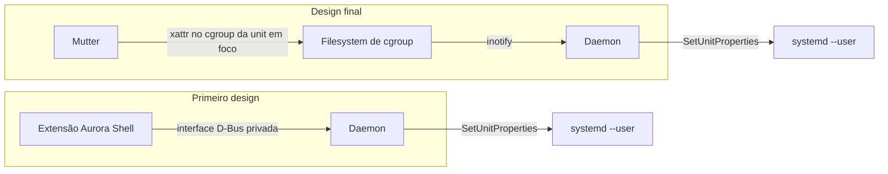

Um build, uma exportação ou uma codificação de vídeo rodando em segundo plano recebe a mesma fatia de CPU que a janela em que você está digitando. Numa máquina ocupada, o app na sua frente pode engasgar enquanto algo que você nem está olhando termina. O KDE tem o `plasma-foreground-booster` para isso. O GNOME não tem nada parecido, então escrevi o `gnome-foreground-booster`, um daemon pequeno em Rust que aumenta o `CPUWeight` do systemd da aplicação em foco e devolve o valor quando o foco sai.

A primeira versão funcionava, mas joguei fora a ideia central dela. O histórico de commits mostra onde o design mudou.

## O primeiro design

Na primeira versão o daemon recebia o foco do Aurora Shell, minha extensão do GNOME Shell. Adicionei um módulo na extensão, o `ForegroundBridge`, que exportava uma interface D-Bus privada, `org.luminusos.AuroraShell.Foreground`. Sempre que a janela em foco mudava, a extensão avisava ao daemon qual app estava com o foco. O daemon mapeava isso para uma unit do systemd e mudava o peso dela.

Funciona, e tem custos. O booster só serviria para quem usa o Aurora Shell, e o daemon precisava de um protocolo privado com uma implementação falsa em GJS para ser testado. Dois componentes acoplados por uma interface que eu tinha inventado para a ocasião.

## O que o Mutter já publica

O Mutter já avisa todo mundo sobre o foco, como se viu. Desde o GNOME 41, o Mutter define um atributo estendido, `user.xdg.inactive-since`, no diretório do cgroup da unit da janela em foco. A unit em foco recebe `-1`. A unit que acabou de perder o foco recebe um timestamp monotônico. Ele só escreve quando o foco passa de uma unit para outra diferente.

Esse é o sinal que eu estava construindo uma bridge para produzir. O commit "read focus from Mutter instead of an Aurora Shell bridge" removeu a bridge, a interface privada e o fake em GJS.



Agora o daemon não tem nenhuma ligação com o GNOME Shell. As únicas entradas dele são o filesystem de cgroup e o `/proc`. A única saída são chamadas ao gerenciador de usuário do systemd por D-Bus. Funciona em Wayland e em X11 e para qualquer usuário de GNOME, inclusive quem nunca instala a minha extensão. O módulo `ForegroundBridge` ainda está na branch do Aurora, mas agora é código morto.

## Como o booster funciona

Ele observa com inotify todo diretório de slice dentro do `app.slice`. A cada mudança de atributo, lê o `user.xdg.inactive-since` de novo e guarda no máximo uma unit em foco. Se mais de uma unit disser `-1` na inicialização, ele não confia em nenhuma e espera a próxima mudança.

Um `cpu.weight` do cgroup v2 só compete entre irmãos. Aumentar o peso de uma folha no fundo da árvore compararia com nada. Então o daemon dá o boost ao filho direto do `app.slice` que está no caminho até a unit em foco, que é onde um app compete com outro. O peso padrão é 400 contra os 100 do systemd.

Alguns detalhes vieram de pensar no que poderia dar errado:

- Um debounce de 150 ms, para que uma sequência rápida de Alt+Tab custe um boost só, no fim, e não vários.
- Ele restaura o peso anterior só se a unit ainda tiver o peso do boost, então nunca desfaz uma mudança feita por outra pessoa.
- O boost ativo é gravado num arquivo de estado no diretório de runtime, e um daemon que morra no meio de um boost consegue desfazê-lo na próxima inicialização.
- O peso é uma propriedade de runtime, então o systemd o descarta quando a unit some.

## A segunda classe de bug

Depois achei um problema que o sinal do Mutter não resolve. O GNOME Shell lança um app e depois pede ao systemd, de forma assíncrona, para movê-lo para um `app-gnome-*.scope` próprio. Um AppImage inicia o programa de verdade logo de cara. Se ele faz fork nesse intervalo, o processo real fica em `org.gnome.Shell@*.service`, e o Mutter atribui a janela dele ao Shell. Vi isso com o AppImage do Ghostty. O daemon nunca pode dar boost na unit do próprio Shell.

A correção é uma etapa de resgate. Quando uma unit nova aparece sob o `app.slice`, o daemon lê o `cgroup.procs` do Shell, seleciona processos cujo pai vive numa unit de app, junta os descendentes que ainda estão no cgroup do Shell e move o grupo para um scope transiente com `StartTransientUnit`. Ele roda em passadas aos 50, 300, 1000 e 3000 ms depois que a unit nova aparece, porque o Shell só move o launcher depois que o cgroup do scope existe e os filhos presos ainda podem fazer fork. Os filhos do próprio Shell, como o Xwayland e os loaders de imagem, têm o Shell como pai e nunca são selecionados.

Há um limite que não consegui remover. O Mutter guarda em cache a unit de uma janela na primeira vez que precisa dela. Uma janela mapeada antes do resgate continua apontando para a unit do Shell até ser fechada e aberta de novo.

No caminho também corrigi um menor. Por padrão o zbus pede um nome no barramento permitindo substituição, então uma segunda instância do daemon roubava o nome da primeira sem avisar. Agora ele pede o nome com `DoNotQueue` e sai se o nome já estiver ocupado.

## O que ele não faz

Terminais recebem o boost, não os seus comandos. O Ptyxis e outros terminais baseados em VTE iniciam cada shell no próprio `*-spawn-*.scope`, que é irmão da unit do terminal. Um build iniciado num terminal em foco não ganha o peso extra. Documentei esse limite no README.

Não tenho benchmark disso. O README diz que o daemon usa cerca de 5 MB de memória e nenhuma CPU quando está ocioso. Ele não diz que o app em foco fica mais rápido, e não vou dizer isso aqui antes de medir. O daemon também ainda não está na imagem do LuminusOS.

## Testes

A lógica de decisão não toca o D-Bus. O `Booster` e o planejador de resgate falam com o systemd por duas traits pequenas, `UnitControl` e `ScopeControl`, então os testes unitários rodam contra fakes.

O script end-to-end, `tests/e2e/run.sh`, faz a coisa de verdade. Ele inicia units descartáveis num slice privado, define o `user.xdg.inactive-since` nelas do jeito que o Mutter faz, imita a corrida de lançamento com uma unit de Shell falsa e roda o daemon real contra o `systemd --user` real. Ele nunca toca nos aplicativos em execução e se recusa a iniciar enquanto outra instância do daemon estiver rodando. O README o registra como verde.

Com o log de debug ligado, cada troca de foco imprime uma linha assim:

```
boosted unit=app-flatpak-org.mozilla.firefox-270084972.scope weight=400
```

Ler o peso diretamente mostra a mesma coisa:

```
systemctl --user show app-flatpak-org.mozilla.firefox-270084972.scope -p CPUWeight --value
```

Ele imprime `400` enquanto o app tem o foco e `[not set]` depois que perde. O próximo passo é colocar o daemon na imagem e medir, numa máquina carregada, o que um app em foco realmente ganha.
