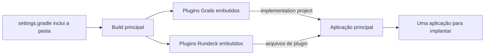
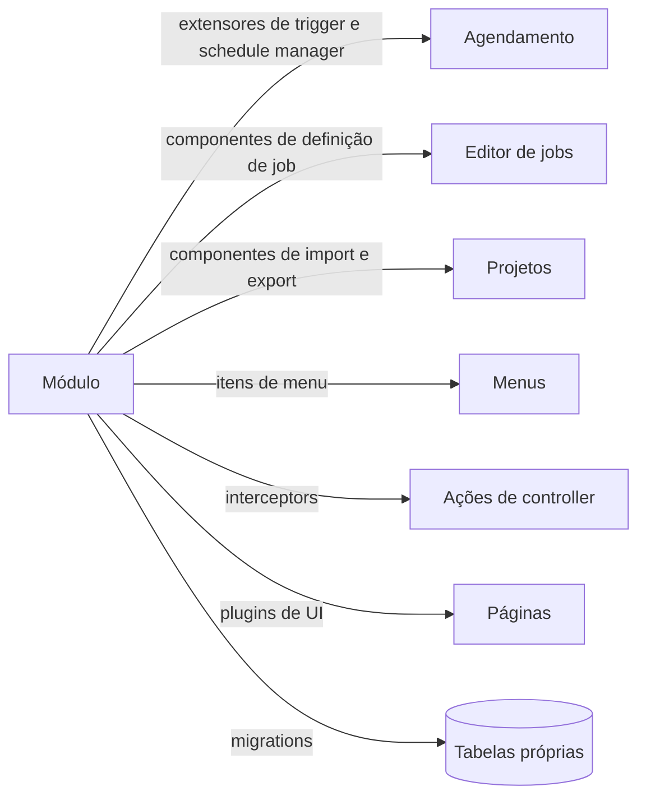

O QWControl é uma plataforma comercial de automação de workloads da QW Software, construída sobre o Rundeck e vendida no mesmo mercado do Control-M. Trabalhei nele de março de 2022 a novembro de 2024. Toda funcionalidade que a empresa adicionou a ele vivia dentro do código do Rundeck. Eu liderei o trabalho de tirar essas funcionalidades de lá, principalmente entre o fim de 2023 e 2024, e a pasta onde elas foram parar se chama `qwcontrolapp`.

Vou manter este texto longe dos detalhes internos, porque o código é da empresa. As decisões, porém, são minhas para contar.

## Como era antes

Um único repositório de código guardava tudo: o motor, a interface web, o calendário, o monitoramento, o licenciamento, as telas de VMware, o editor de nós e a documentação. As funcionalidades dividiam o mesmo build e a mesma release. Uma mudança no calendário ficava na mesma árvore de uma mudança no dashboard de VMware, e nenhuma das duas podia ser compilada ou testada sem a outra.

Esse formato funciona para um produto com três funcionalidades. O QWControl tinha muito mais.

## O que eu queria

Cada funcionalidade deveria ter uma casa: pasta própria, arquivo de build próprio e testes próprios, e a aplicação principal carregaria o módulo na inicialização. Se um módulo estivesse ausente, o restante do produto continuaria rodando.

O Grails já tem o mecanismo certo para isso, que é o plugin. O Rundeck também tem um modelo de plugins para passos de job, então havia dois tipos de peça para separar:

- módulos para funcionalidades da plataforma, como a interface, o calendário, o licenciamento e o monitoramento;
- plugins para passos e estratégias de job, como SAP, NetBackup, scripts SQL e transferência de arquivos.

## Como eu fiz

Fiz em movimentos pequenos, um módulo por vez. O calendário foi o primeiro e ganhou o próprio pull request em outubro de 2023. Monitoramento, nó interativo, gerenciador de recursos, licença, melhorias de interface e rule flow vieram nas semanas seguintes.

No dia 24 de novembro mudei o build para que todo módulo fosse declarado em uma única lista de plugins embutidos no build principal. Três dias depois, um único commit moveu os arquivos restantes para `qwcontrolapp/`. Daí em diante, criar um módulo era criar uma pasta e adicionar uma linha a essa lista.

A interface teve uma etapa própria. Em 2024 levei os frontends do monitoramento e do editor de nós para um único pacote, o `spa-ui`, com uma pasta por tela. A página de monitoramento, o dashboard de VMware e o editor de rule flow agora compartilham a mesma base e o mesmo visual.

## O build e os pontos de encaixe

O build é a parte que torna o resto possível. O arquivo de build principal tem duas listas, uma para módulos Grails e outra para plugins Rundeck. O projeto da aplicação transforma cada entrada da primeira lista em dependência e empacota a segunda como arquivos de plugin. Um módulo comentado nas configurações e na lista simplesmente sai do produto.

Em tempo de execução, o módulo se encaixa no núcleo por pontos de extensão que o Rundeck já tem, então o núcleo nunca importa o módulo. O calendário, por exemplo, estende a construção dos triggers, o módulo de licença liga e desliga funcionalidades que outros módulos leem, e os módulos de interface injetam scripts nas páginas pelo caminho.

## O que mudou depois

O trabalho com VMware em 2024 foi um bom teste. Começou como plugin, cresceu para um dashboard, um job horário de métricas e relatórios, e virou um módulo com verificação de licença própria.

O módulo de licença agora decide, funcionalidade por funcionalidade, o que uma instalação pode usar. Uma mudança na página de monitoramento não divide mais a árvore com uma mudança no calendário. Adicionar suporte a z/OS na transferência de arquivos mexeu apenas no plugin de transferência de arquivos.

Os resultados estão em [VM Dashboard Monitor](/work/vm-monitor-dashboard/), [editor de Rule Flow](/work/qwcontrol-rule-flow-editor/), [Daily Job Monitoring](/work/qwcontrol-job-monitoring/), [plugins de integração](/work/qwcontrol-integration-plugins/) e [módulos da plataforma](/work/qwcontrol-platform-modules/).

## O que ficou

O arquivo de build foi o que mais pesou. Quando ele passou a carregar um módulo a partir de uma pasta, mover cada funcionalidade virou um passo mecânico, e a pergunta que sobrou foi onde cada peça deveria morar.
