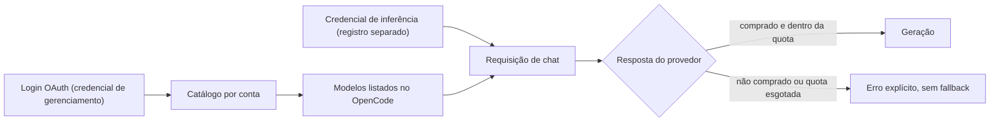

Escrevi dois plugins para o OpenCode que conectam ele a provedores de modelos que eu uso: um para o QwenCloud e outro para o JetBrains Junie. Os dois são não oficiais. Eles falam com endpoints que os fornecedores não documentaram para esse uso, então não vou descrever esses endpoints aqui. Este post é sobre o design, porque foi ali que eu aprendi alguma coisa.

A primeira lição veio cedo. Depois de um login OAuth bem-sucedido eu tinha uma conta conectada, um catálogo de 186 entradas de modelos no lado do QwenCloud e um plugin que parecia pronto. Aí uma requisição de chat voltou com "model not purchased", e outra com "monthly quota exhausted". O provedor recebeu minha requisição e recusou. Nunca consegui uma geração completa em nenhum dos dois plugins, e os READMEs dizem isso.

## Três tipos de "logado"

Um login prova quem você é. Um catálogo prova o que o provedor lista para a sua conta. O direito de uso (entitlement) prova que você consegue rodar uma requisição agora, e só a resposta do provedor a uma requisição real mostra isso. Um plugin que trata o primeiro como se fosse o último vai mostrar no seletor modelos que falham quando você escolhe.

O login de gerenciamento e a credencial de inferência ficam em registros de credencial separados no OpenCode. Um modelo listado não é tratado como prova de que a conta pode usá-lo, e uma resposta de quota que o plugin não reconhece nunca vira saldo zero. O plugin também nunca lê os arquivos privados de login da CLI do fornecedor e nunca cria chaves em seu nome. Cada ferramenta continua responsável pelas próprias credenciais.

## O serviço errado

A primeira versão do plugin do QwenCloud integrava com o produto errado. QwenCloud e Qwen Code são serviços diferentes. Percebi lendo o código-fonte da CLI oficial e troquei a integração inteira num único commit. Desde então, cada afirmação sobre o protocolo no repositório do Junie tem uma entrada num documento de procedência, com uma URL de origem fixada num commit da CLI oficial, uma data e uma nota sobre o que eu não fiz (nenhuma inferência chamada, nenhuma chave criada, nenhum polling aprovado). Valores de query contam como segredo e URLs completas nunca entram em mensagens de erro.

## Um cache que não vaza entre contas

Os dois plugins fazem cache do catálogo de modelos. O cache é particionado por conexão, roteamento e schema, então um snapshot feito numa conta não pode ser publicado em outra. Trocar de conta invalida o que o OpenCode já tem listado. O código confere a conta antes e depois de cada chamada assíncrona, o que impede que uma resposta lenta da conta antiga caia na conta nova. Quando um acesso é revogado, um tombstone impede que aquele metadado volte depois de um reload.

No lado do Junie, o gateway anuncia 60 IDs de modelo para a minha conta, e 36 deles batem com o catálogo embutido no cliente Junie que usei como referência. Só esses 36 são publicados no OpenCode, como 36 modelos com 159 variantes. O plugin também confere o armazenamento local a cada 15 segundos para manter os outros locais do OpenCode em sincronia, e marca um snapshot como desatualizado depois de 24 horas.

## Quota que sabe dizer que não sabe

Dados de quota chegam parciais, atrasados ou num formato que o plugin não reconhece, e o tratamento fácil é mostrar 0. Um zero lê como "não sobrou nada", o que é uma afirmação. Por isso cada plugin separa desconectado, desconhecido, parcial, falhou, ausente e disponível. Erros e valores ausentes nunca viram zero nem "não assinante", e um zero de verdade continua sendo zero (o código checa presença, não truthiness). As outras unidades recebem o mesmo cuidado: créditos não são tokens brutos, o agregado de um time não é a alocação individual e uma data de expiração não é uma data de reset.

## Hardening da requisição

A requisição final passa por um funil estreito. Ele aceita um único caminho POST fixo, para um destino fixo. O modelo no corpo precisa existir no catálogo ativo. Os headers de upstream são substituídos pelos do próprio plugin, redirects são recusados, retries ficam desligados e não existe fallback automático para pay-as-you-go nem para outra conta. Um fallback que gasta dinheiro sem ninguém pedir é uma surpresa ruim, então qualquer troca tem que ser uma escolha explícita do usuário.

Testando o plugin do Junie, encontrei também uma falha na forma como o host repassa as requisições, e ela enfraquece a garantia contra redirects. Deixo os detalhes fora deste post. O README do plugin avisa para não rodar inferência real até o host ser corrigido.

Os timeouts fazem parte do mesmo design. O deadline é imposto antes de os headers da resposta chegarem e durante todo o corpo em streaming, e o timer e o controller pertencem ao escopo da requisição, então cancelar a requisição cancela o leitor também. A requisição mantém referências fortes a eles, e um teste de regressão força o garbage collector para checar que o deadline continua disparando.

## Um adaptador loopback com chave própria

O OpenCode tem um plugin de quota que consegue ler de uma fonte HTTP local. Expus a quota do Junie por um adaptador pequeno que escuta só em 127.0.0.1, responde só `GET /quota` e devolve o formato quota-v1 que esse plugin entende. Ele tem uma terceira credencial, independente das outras duas, e rejeita query strings, header Host errado, qualquer Origin de navegador e headers Authorization duplicados. Conexões, tamanho de payload e tempo têm limite. Rodo o adaptador como uma unit transitória do systemd de usuário, que não sobrevive a um reboot, e a documentação diz isso.

O adaptador me rendeu a melhor história de debugging. O painel insistia em dizer que o provider customizado não estava configurado. A causa era que a chave do adaptador não estava no ambiente do processo servidor do OpenCode. Definir a chave no meu processo de reparo falhou, porque outro cliente tinha ganho a corrida para iniciar o serviço com o ambiente antigo dele. A correção foi gravar a chave na configuração privada de ambiente do servidor e reiniciá-lo.

## Registrando as falhas

Cada repositório registra seus limites ao lado das suas afirmações: as checagens ao vivo retornaram erros de compra e de quota, e nenhuma geração completa. No lado do QwenCloud, verifiquei login e catálogo ao vivo, e o chat chegou ao provedor e foi recusado. Os dois repositórios têm cerca de 77 casos de teste (QwenCloud) e 74 (Junie), e eles exercitam o comportamento dos próprios plugins com credenciais sintéticas. Eles não dizem se um provedor vai aceitar a requisição de uma conta específica.

O que continua em aberto: uma geração ponta a ponta bem-sucedida num plano pago em qualquer um dos provedores, e o problema do host que mencionei. O plugin do QwenCloud ainda está só local, e o do Junie é público e não tem arquivo de licença.
