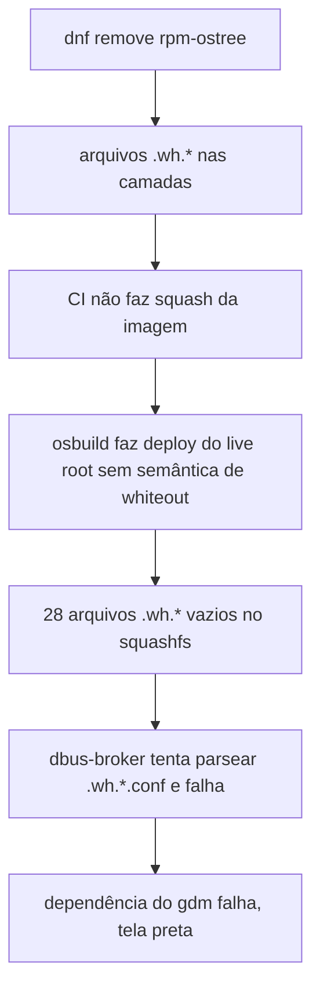

O LuminusOS é um desktop GNOME imutável que eu construo como uma imagem bootc a partir de um Containerfile. Um dia a ISO gerada pelo CI passou a bootar até o splash do Plymouth e ficar numa tela preta para sempre. O boot test do CI dizia a mesma coisa do jeito dele: "Final screendump has 1 distinct sampled colors".

O qcow2 gerado a partir da mesma imagem workstation bootava normalmente. Mesmo build, duas saídas, só uma quebrada.

## Como o boot test enxerga uma tela preta

O smoke test é um script bash que boota a ISO ou o qcow2 sem interface gráfica no QEMU com UEFI. A cada 30 segundos ele pede um screendump ao QEMU via QMP, até 420 segundos no caso da ISO. Depois conta as cores distintas do último screenshot. Uma tela preta tem uma cor, um console de texto tem menos de 32 e uma superfície do GNOME renderizada tem centenas. O limite é 64. O OCR também roda, mas só como informação auxiliar.

É um teste grosseiro, e eu gosto dele porque não depende do que está desenhado na tela, só de existir alguma coisa desenhada.

## Lendo o console serial

Um screenshot preto não diz nada, então bootei a ISO localmente com console serial. As linhas úteis foram estas:

```
dbus-broker-launch: Invalid XML in /usr/share/dbus-1/system.d/.wh.org.projectatomic.rpmostree1.conf
Failed to start dbus-broker.service
DEPEND Dependency failed for gdm.service
```

O dbus-broker lê todo arquivo de `system.d` como política do barramento. Um deles era um arquivo vazio chamado `.wh.org.projectatomic.rpmostree1.conf`, que não é XML válido, então o system bus nunca subia. O GDM depende dele, então o display manager nunca iniciava.

## O que é um whiteout

Uma imagem OCI é uma pilha de camadas. Uma camada não consegue apagar um arquivo de uma camada abaixo. Para escondê-lo, ela grava um marcador vazio chamado `.wh.<nome-do-arquivo>`, o whiteout. Ferramentas que aplicam camadas, como Podman, Docker e o overlayfs do kernel, leem o marcador e escondem o arquivo.

Meus Containerfiles removiam o `rpm-ostree` da imagem com `dnf remove`. Cada arquivo removido deixava um whiteout numa camada superior. O live root da ISO é montado pelo osbuild, e o osbuild fazia o deploy dessa imagem sem aplicar a semântica de whiteout. Os marcadores viraram arquivos reais e vazios no squashfs. Eram 28. O qcow2 passa pelo caminho de deploy do ostree e do bootc, que respeita whiteouts, e por isso funcionava.



Nenhum elo da cadeia está errado nos próprios termos. A spec OCI não obriga um consumidor a aplicar whiteouts como o overlayfs faz, e eu é que estava entregando uma imagem que dependia deles.

## Corrigindo em camadas

A primeira correção foi reverter a remoção. Tirar o `rpm-ostree` de uma imagem gerenciada pelo ostree era uma má ideia de qualquer forma, e era a origem dos marcadores.

As tentativas seguintes foram de squash. Testei `--squash-all` no build e depois um `buildah commit --squash` após o build, para manter o cache de camadas. O squash aplica os whiteouts e deixa uma única camada com o filesystem final.

O que ficou foi uma proteção estrutural no `Containerfile.installer`, o Containerfile do live root. O último estágio é:

```dockerfile
FROM scratch
COPY --from=live / /
```

Isso copia o filesystem já mesclado para uma camada nova, então nenhum `rm` de um estágio anterior consegue vazar um whiteout. Uma checagem em tempo de build reforça: o `RUN` de verificação falha o build se o `find` encontrar qualquer arquivo chamado `.wh.*`.

A lição que anotei é que quem consome uma imagem OCI não é obrigado a respeitar whiteouts. Se uma ferramenta de terceiros vai copiar o filesystem para fora da imagem, entregue a imagem sem nenhum.

## A segunda falha não tinha nada a ver com o build

Depois da correção o boot test continuou falhando. Dessa vez os screenshots mostravam o instalador Sirius perfeitamente até os 330 segundos e preto a partir dos 360.

O build estava certo. O `idle-delay` padrão do GNOME é 300 segundos, e a VM de teste nunca mexe o mouse. Uns 60 segundos de boot mais 300 de ociosidade dão tela preta no screendump final, aos 420. A tela estava apagando, como foi projetado.

Resolvi nos defaults do dconf que só existem na ISO live: `idle-delay=0`, sem dim, sem suspensão, sem screensaver. Eu vejo isso mais como regra de produto do que como ajuste de teste. Um instalador nunca deveria se esconder de quem está usando. O ambiente de teste headless é só o primeiro lugar onde aparecem defaults pensados para um usuário sentado na frente da máquina.

## A terceira: uma tag que não foi gravada

Mais tarde, a instalação a partir da ISO falhou com este erro:

```
no descriptor found for reference "latest"
```

A ISO carrega o payload do sistema como um diretório OCI layout, e o `bootc install` o lê por referência. Eu tinha exportado o payload com skopeo para um destino sem tag, `oci:.test/payload.oci`. Nesse caso o skopeo não grava a anotação `org.opencontainers.image.ref.name` no `index.json`. O instalador procurava um descriptor anotado como `latest` e não achava nenhum.

O destino precisa ser `oci:.test/payload.oci:latest`. O skopeo tira a tag do nome do diretório em disco e a grava como anotação. Agora o Containerfile confere isso com `jq`, então uma anotação ausente quebra o build em vez de quebrar a instalação:

```
jq -e '.manifests[0].annotations."org.opencontainers.image.ref.name" == "latest"'
```

Os recipes locais do Just e o workflow do CI também usam o mesmo script de empacotamento, então os dois caminhos não divergem na forma de exportar o layout.

## O que eu verifico primeiro da próxima vez

Quando uma ISO e uma imagem de disco da mesma origem discordam, olho como cada uma é implantada antes de olhar o conteúdo. As duas podem ler a mesma imagem OCI e aplicar regras diferentes a ela. Também leio o console serial antes de qualquer outra coisa, porque tela preta é um sintoma com um número enorme de causas e uma linha de log tem uma só.

O pipeline de releases do LuminusOS ainda está em movimento. O canal testing publica todo dia e o primeiro release stable espera o Fedora 45 sair.
