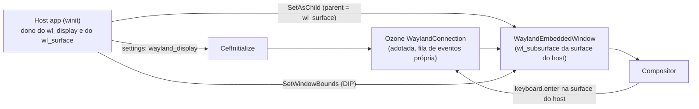

O CEF tem o `SetAsChild` há anos. No X11 você passa o ID de uma janela e o navegador aparece dentro dela. No Wayland a mesma chamada pode deixar uma janela solta flutuando na tela, retornar sucesso sem desenhar nada ou derrubar o processo. A issue upstream desse problema (chromiumembedded/cef#2804, "Linux: Add support for embedded Ozone/Wayland windows") foi aberta em 2019 e continua aberta.

Passei uma parte deste ano nela. Abri o pull request #4233 no CEF, e ele ainda está aberto, sem merge. Este post é sobre por que o problema existe e como é uma correção. Escrevi o patch com bastante ajuda do Claude Code, os commits levam o trailer `Assisted-by: Claude Code`, como a política de IA do CEF pede, e assumo a responsabilidade por tudo.

## Três formas de embutir o CEF

O CEF tem três formas de mostrar um navegador dentro de uma aplicação no Linux. O Views entrega uma janela de nível superior gerenciada pelo CEF e funciona no Wayland há alguns anos. O off-screen rendering (OSR) entrega buffers de pixels para você desenhar do seu jeito, e funciona há bastante tempo (o Spotify usa). A terceira é o modo de janela nativa, em que o host passa um handle de pai pelo `SetAsChild` e o CEF cria uma janela filha dentro dele. Só a terceira não existe no Wayland, e é só dela que a issue #2804 trata.

## Um ID de janela X11 é global, um wl_surface não

No X11, um `Window` é um ID de 32 bits que pertence ao servidor X. Qualquer cliente pode usá-lo. O CEF abre a própria conexão com o servidor, e `x11::Connection::CreateWindow()` recebe o pai como um inteiro comum, então a janela nova pode viver dentro de uma janela criada por outra conexão.

Um `wl_surface` é um objeto de protocolo. Ele só existe dentro da conexão `wl_display` que o criou, e o `wl_subcompositor_get_subsurface()` exige que pai e filho estejam na mesma conexão. Um processo de navegador que abre a própria conexão Wayland não tem como se referir à surface do host. Todas as outras dificuldades do problema vêm dessa regra.

## O que o CEF faz hoje

Escrevi um app host pequeno em Rust para enxergar as falhas (é um projeto separado, o `cef-wayland-embed-sample`). Isto é o que a mesma chamada `SetAsChild` produz no Fedora 44 com GNOME 49:

| Cenário | Resultado |
|---|---|
| `windowed-x11` (controle) | Uma janela filha dentro do painel. O XID fica numa faixa diferente da do host (`0x1c00004` contra `0x2a00004`), o que mostra que veio de outra conexão. |
| `windowed-wayland` | Uma janela XWayland solta flutua sobre o host. O `libcef.so` de release ainda tem o backend X11 compilado, e o `parent_window` chega como 0. |
| `windowed-wayland --no-xwayland` | `CreateHostWindow()` retorna `true`, `GetHostWindowHandle()` retorna `0xffffffff` e o painel fica vazio. |
| `osr` | Funciona: 39 chamadas de `OnPaint` em 12 segundos a 1224x582. |
| `views` | Funciona, numa janela de nível superior separada. |

Os dois casos de janela nativa no Wayland terminam com um `SIGSEGV` em `WaylandWindowManager::GetWindow` quando o primeiro evento é despachado, porque o XID é usado como `gfx::AcceleratedWidget`.

Esses sintomas se parecem com o que as pessoas relatam do Steam no Wayland: janelas em branco e menus mortos. Se o Steam realmente usa esse modo de embedding é um palpite a partir dos sintomas, e eu não verifiquei. Uma teoria popular eu chequei: a de que o merge do ANGLE Wayland em maio de 2026 resolveria isso. O mantenedor do CEF disse em junho que não, e o embedding roda num checkout do Chromium cujo ANGLE só tem o caminho Vulkan Wayland antigo. O processo de GPU nunca toca o Wayland: ele renderiza em buffers dmabuf e o processo do navegador apresenta.

## Compartilhando a conexão

A abordagem que implementei faz o host entregar o `wl_display` ao Chromium, e o Chromium adota essa conexão em vez de abrir uma nova. O `WaylandConnection` do Chromium já cria uma fila de eventos dedicada e envolve o display num proxy, justamente para não dar flush em mensagens de outros usuários da conexão. Dois dispatchers numa conexão só viraram um problema menor do que eu temia. A adoção precisa ser global ao processo, porque o Ozone inicializa dentro do `CefInitialize`, antes de existir qualquer `CefWindowInfo`. Um protótipo da Igalia de 2020 colocava o display no `CefWindowInfo`, o que não funciona.

A janela do navegador vira uma `WaylandEmbeddedWindow`, um `wl_subsurface` da surface do host, registrada no `WaylandWindowManager` para que as buscas de widget funcionem. Não precisei de um gêmeo Wayland do `CefWindowX11`, uma classe de 539 linhas, porque no Wayland a janela embutida já é a janela de plataforma do host do views. O views só entende um pai nativo como `gfx::AcceleratedWidget` e já repassa isso ao Ozone, então registrar a surface do cliente produz um e nada no views muda.

Uma armadilha: o views mapeia `TYPE_CONTROL`, que o navegador embutido usa, para um tipo de janela popup, então a checagem de pai estrangeiro precisa rodar antes do switch de tipo em `WaylandWindow::Create()`.

## O que veio de graça e o que não veio

Um subsurface nunca recebe `wl_keyboard.enter`, e a thread da issue tinha concluído que o embedder precisava repassar todas as teclas. Não precisa. O Chromium já recebe esses eventos na conexão compartilhada e os descartava, porque não conseguia resolver o toplevel do host. Ensinar essa busca sobre as surfaces estrangeiras registradas roteia o foco de teclado sem código no embedder.

A mesma busca escondia um bug de segurança de memória. Ela convertia o user data de qualquer `wl_surface` para um ponteiro do Chromium, e numa conexão compartilhada esse dado pertence ao toolkit do host (GTK e Qt ambos o preenchem). Reproduzi como crash passando o mouse sobre as bordas de janela desenhadas pelo cliente no winit. A correção marca as surfaces do Chromium com `wl_proxy_set_tag()` e só resolve as marcadas. O drag and drop passa a ser atribuído corretamente sem equivalente ao `XdndProxy`, porque cada lado responde só pelas próprias surfaces.

Popups deram mais trabalho. Um `xdg_popup` precisa de um pai `xdg_surface`, e um subsurface não tem. O host pode passar o próprio `xdg_surface` num campo opcional, já que os dois compartilham processo e conexão. Sem ele, o CEF cai num subsurface degradado que é cortado na borda da janela e não tem grab.

A geometria também muda. Um subsurface não recebe evento `configure`, então o host precisa empurrar os limites por um novo `CefBrowserHost::SetWindowBounds()`. Esses limites são em DIPs, já que `wl_subsurface.set_position` é local à surface. No começo meu host em Rust passava pixels físicos, o que parece certo na escala 1.0 e joga o navegador para fora da tela num monitor 1.25.

## O que o mantenedor disse

Depois que escrevi esse design, o mantenedor do CEF revisou o pull request em 20 de outubro e reverteu várias escolhas. A que importa aqui: eu tinha feito o `parent_window` carregar o ponteiro do `wl_surface`. Um XID válido e um endereço parecem iguais, então um handle errado vira comportamento indefinido, e não um erro que o CEF consiga reportar. Ele pediu um campo separado para o pai Wayland, mantendo o `parent_window` para o X11. Também quer o display no `CefSettings` em vez de um setter, um caminho Wayland no `cefclient` em vez do meu sample avulso, e evidência no KWin além do Mutter. Estou dividindo o trabalho numa série menor que começa pela mudança de settings.

## O que consegui e o que não consegui verificar

Tudo acima rodou no Fedora 44 com GNOME 49 (Mutter), em dois monitores com escalas diferentes. O IME funciona com ibus e Intelligent Pinyin: preedit, janela de candidatos junto ao cursor e commit. Não compilei no macOS, não testei outro compositor e não observei composição CJK numa sessão longa nem uma troca de escala com um popup aberto. O resize também atrasa um frame em relação ao host, porque a posição do subsurface é double-buffered no pai, e o mesmo TODO existe no upstream.

Alguém relatou que menus popup caem no lugar errado no Plasma 6.7.3. Ainda não tenho um ambiente KDE, e esse é o próximo ponto que o mantenedor pediu para eu provar.
