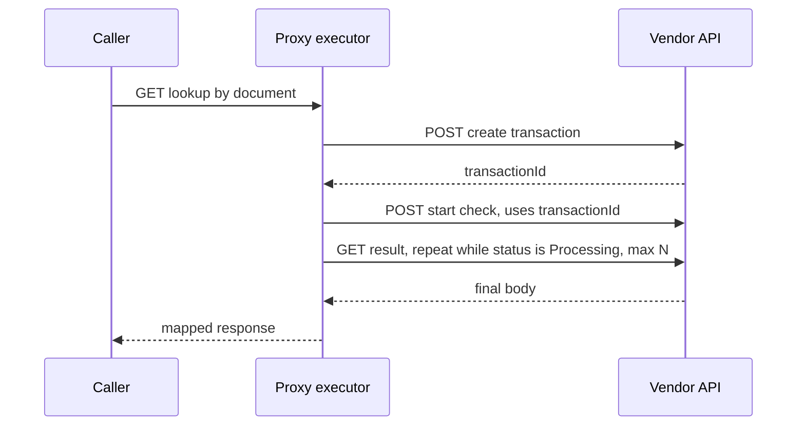

This was client work for a health plan operator in Brazil, so I only describe components and flows here. The proxy I built has a simple rule: one endpoint makes one call to the target service. That held until the first integration that needed three.

A third-party verification API wants you to create a transaction, then start a check on that transaction, then fetch the result. The internal systems that consume the proxy do not care about any of that. They want to send a document number and get an answer. So the job was to turn those three calls into one GET.

## The caller's contract

The contract is the simple part, and I fixed it first. The caller sends a GET with the document as a path variable, the same shape as the other lookup endpoints in the proxy. Everything else, including the fixed fields the vendor wants in each request body, lives in the endpoint configuration.



The proxy returns the body of the last step.

## Three designs

I wrote a short design spec before coding, and it compares three options.

The first was a Java handler written for this vendor. It is the fastest to build, and it is exactly what the proxy exists to avoid. The next vendor with a multi-call flow would need another handler and another deploy. My spec says it plainly: it does not generalize.

The second was a JSON blob with the steps inside the endpoint table. It is flexible, but it breaks the relational pattern of the rest of the model. The API cannot validate it field by field, and it would disappear from export and import unless I special-cased it.

The third was a relational child table, one row per step, with an order that is unique per endpoint, and a generic executor that reads those rows. That is what I built. It fits how everything else in the proxy is stored, the admin API can validate it, and export and import carry it along.

Each step has a method, a path and a body template. Templates use placeholders like `{documentId}`. A placeholder resolves either from the route or from a variable extracted from an earlier step's response, using a dot path.

```json
{
  "order": 2,
  "method": "POST",
  "path": "/transactions/{transactionId}/checks",
  "body": "{\"type\": \"standard\"}",
  "extract": { "checkId": "data.id" }
}
```

## Executor rules

Most of the work was deciding what the executor refuses to do.

Values extracted from a response end up inside a URL, so they pass through the same regex as path variables before they are used. A vendor response is untrusted input as much as a caller request is.

Validation happens when the configuration is written, not when the first caller hits it. Orders must be contiguous and unique, templates must be valid JSON, and every placeholder must be resolvable from the route or from an earlier step. A step cannot reference something that runs after it.

Only GET steps retry. A POST never retries, because a repeated POST could create a duplicate transaction at the vendor. Timeouts apply per step, which means the caller's own timeout has to be longer than the sum of the steps. I documented that as a known limit.

There is no table for execution state. State exists only during the call, and the central log service already records the request and response pair of each step. There is also no compensation. If step two fails, the transaction from step one stays at the vendor as an orphan. I judged that harmless and wrote it down.

## The no-polling decision

The vendor's result endpoint can answer while the check is still processing. In the first spec, I decided there would be no polling: step three is a single GET, and if the vendor is not done, the call fails. It kept the executor simple, and I liked that.

After tests in homologation and production, that decision did not hold. Step three could run while the vendor still reported the check as processing, and the call failed for a result that would have been ready a moment later. So I added a per-step wait rule:

```json
{ "field": "status", "while": "Processing", "intervalMs": 1000, "maxAttempts": 15 }
```

It applies to GET steps only. The interval must be between 1 and 10000 ms, and attempts between 1 and 30. When attempts run out while the field still matches, the step fails. The bounds exist because of the timeout rule above: a wait rule is also a promise about how long the caller will wait.

The spec itself had a "phase 0" task, to validate the vendor's three routes by hand before building anything, and it noted that the vendor's documented JSON had unbalanced braces and an ambiguous identifier name. The vendor's documentation was already known to be imperfect, and I still designed around what it said.

## Testing with a scripted mock

For local work I wrote a small mock of the vendor API in Python. It returns scenario responses depending on the input document: errors, timeouts, and a "still processing" phase. The polling rule was developed against that mock, and the same scenarios work as a smoke test after each change.

## Rollback and open risks

Rollback is cheap because the DDL is additive. The previous version of the application ignores the new table, so deploying and reverting does not touch the existing proxies. To switch off a flow, I set its proxy to inactive. Smoke tests of the existing proxies in the plan prove there is no regression.

Some risks remain open. Import and export do not carry authentication, so promoting this flow from homologation to production needs a manual credential link. The vendor's full responses contain personal data, and they land in the central log. Whether to mask them per step is still a decision to make. And the caller must not retry on its own, since a retry would start a second transaction at the vendor.
