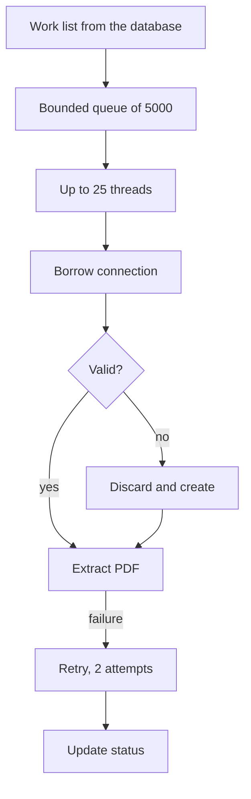

In 2025 I worked on a billing and communications platform for telecom operators. One of its batch jobs pulls invoice PDFs out of a document archive for a group of large corporate customers, then compresses and encrypts them for delivery. This was client work, so I describe only components and flows, with generic names.

The archive is accessed through a proprietary client library. It has no connection pool, and a connection cannot be used by two threads at the same time. The extraction step I worked on has to move a lot of documents, so I hardened how many threads share a small set of connections.

## The problem with the obvious options

A single shared connection is out, because the client is not thread-safe. One thread would be correct and slow.

A connection per task is correct and also slow, because opening a connection costs far more than one request. A connection per thread kept for the whole run is better, but a run is long, and a connection that sits idle or breaks halfway would take a thread down with it.

What I needed was a pool: a fixed set of live connections that threads borrow one at a time and return, with checks so that a dead connection never reaches a worker.

## The pool

The pool is a blocking queue of live connections. Its size is 15. It starts with half of them and a minimum of 5, and the rest are warmed up asynchronously with a 30 second limit, so the job begins working before the pool is full.

```java
Connection borrow() throws InterruptedException {
    Connection c = idle.poll();
    while (c != null && !c.isAlive()) {
        discard(c);
        c = idle.poll();
    }
    return c != null ? c : createWithinLimits();
}
```

Borrowing takes an idle connection and checks it with a cheap call. A connection that fails the check is discarded and the next one is tried. When the queue is empty, the pool creates a new connection on demand, up to one and a half times the configured size. The same cheap check runs when a connection is returned, so a connection that broke during a request does not go back into the queue.

Creation is the dangerous moment. If twenty threads find the queue empty together, all twenty would open a connection at once. A semaphore with three permits limits how many connections are being created at any time, and the other threads wait on it.

A maintenance task runs every 60 seconds and replenishes the pool toward its target size, replacing connections that were discarded.

## The executor around it

The pool only protects the archive. The rest of the job needs its own limits, and this is where the bounds come from:

```java
new ThreadPoolExecutor(n, n, 0L, TimeUnit.MILLISECONDS,
        new ArrayBlockingQueue<>(5000),
        new ThreadPoolExecutor.CallerRunsPolicy());
```

The thread count is the smaller of 25 and a configured throttle. The queue holds at most 5,000 tasks, because the work list can be much larger than that and an unbounded queue would put all of it in memory. When the queue is full, the caller policy makes the submitting thread run the task itself. That slows the submission and gives back-pressure with no extra code.

A latch counts finished tasks, and the main thread waits on it for at most 60 minutes. On timeout it shuts the executor down immediately and logs how many tasks never ran, so a stalled run ends with a number and not with a silent hang. Progress is logged every 100 items with a percentage, and the counters behind it are atomic.

With 25 threads and a connection ceiling of roughly 22, some threads wait for a connection when everything is busy. I would measure that pair of numbers again before copying it to another system, since they are configuration values and not the output of a careful benchmark. The archive also limits a request to 100 results per page, and the database side has its own pool of at most 50 connections, which is separate from this one.



## When a document fails

Each item gets two attempts with a 500 millisecond pause between them. That covers the usual short failures without hiding a real problem for long.

The business side has its own limit. Every invoice has a row in a control table with a status and an attempt counter. After three failed tries, the row ends in a final "not available" state and the document appears in a report of documents that were not found. The job still finishes with a success exit code and a warning, because a missing document is a fact about the archive and should not fail a whole cycle. Failing fast is the right answer for a bad key or a missing input folder, which the job checks before any work starts.

## Mistakes around it that I did not repeat

Older services in the same pipeline waited for their pools with an empty loop on `isTerminated()` and submitted work with `execute()`. The loop burns a core while it waits. The second habit is worse: an exception thrown inside an `execute()` task goes to the thread's uncaught exception handler, and the job carries on as if the task had worked.

The hardened version waits on a bounded latch instead of spinning, keeps progress in atomic counters and ends with a count of what did not run. The latch, the bounded queue and the timeout follow one rule: every wait in the job has a limit, and every limit leaves a log line. If I were fixing the older services, I would also replace `execute()` with `submit()` and read the result of each future, so that a failed task surfaces.

## What I would use today

I would not write the pool again. Apache Commons Pool 2 has validation on borrow and on return, a maximum wait for borrowing, idle eviction and a way to cap the total number of objects. It covers most of what I coded by hand, with more tests behind it than I will ever write.

The part I would keep is the semaphore around creation, in a factory, if the archive still reacts badly to connection bursts. I would also put the pool's numbers (size, creation limit, maintenance period) in one configuration object with a name for each, because in the current code they are easy to lose among dozens of other keys.
