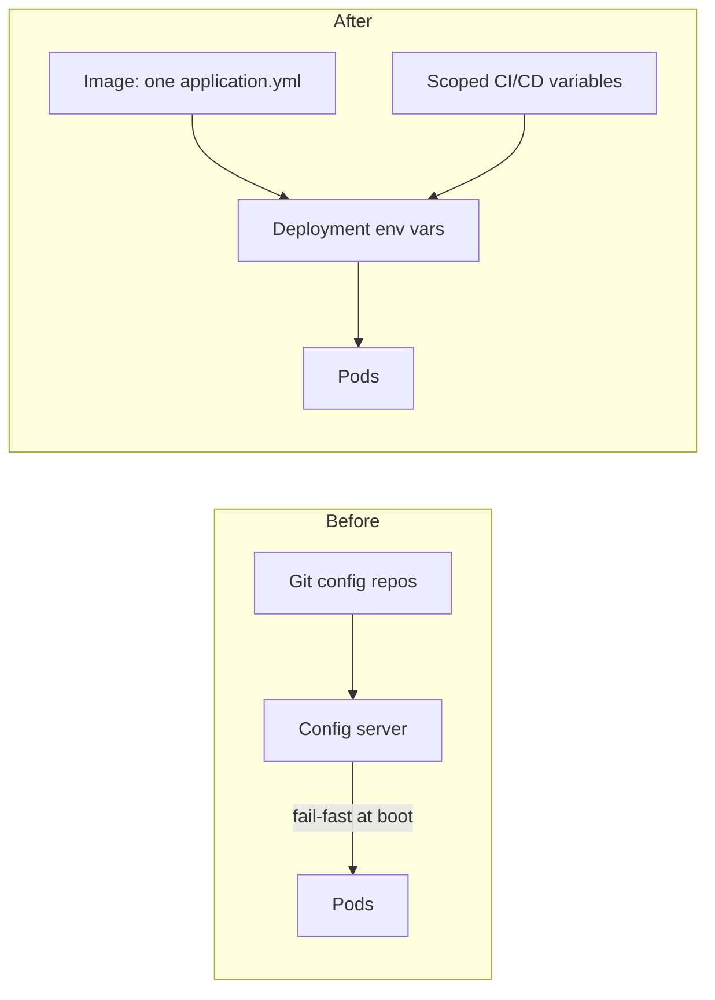

I worked on the backend of Brazil's national health data network (RNDS) as a contractor for the public health IT agency, and this post describes components and flows only, nothing about the environments or their values.

Every service in the platform used to get its configuration from a Spring Cloud Config server. The server read per-environment git repositories, one folder per application and one profile per state, and each pod fetched its configuration at boot with `fail-fast` enabled. I removed that dependency from eight services and moved configuration into the services themselves.

## What it looked like before

The platform runs one deployment per state for each service, so a pod's profile was its state code. At startup the pod called the config server, the server answered from the git repo for that environment, and the pod continued booting with those values.



It worked, and that is the reason it lasted. The problems showed up when I looked at it as a dependency graph.

## Why I wanted it gone

With `fail-fast`, no pod can boot without the config server, and that includes pods that autoscaling starts in the middle of a load peak. The server has to be up exactly when many pods ask for configuration at once. A cold start after a disaster recovery has the same dependency: git reachable, config server up, and only then the services. A single failure in that chain stops everything behind it, and the chain has nothing to do with the business logic.

The feature that would have justified the extra moving part was dynamic refresh through a message bus. It was configured, but the trigger endpoint was never exposed, so in practice it did nothing.

There were two more reasons. Spring Cloud Config on the client side relies on bootstrap contexts, and the server is a reactive Netty application. Neither works well with native images, which I was working on at the same time. And a server that can answer with the configuration of every service is a single place on the network that holds all of it, which I preferred not to keep.

## The design I used

The alternative on the table was ConfigMaps and a parameter store, with an operator syncing secrets from a cloud secrets manager. It is a reasonable design, and the choice of secrets provider does not change the architecture. I went with something smaller that used what the pipeline already had.

- A single `application.yml` baked into the image, holding production defaults.
- Environment-specific values passed as environment variables in the Deployment manifest, rendered with `envsubst` in the deploy job.
- Secrets stored as CI/CD variables scoped per environment (dev, staging, training, production) and masked where the CI system allows it.

Spring Boot already maps environment variables onto properties, so `SPRING_KAFKA_BOOTSTRAP_SERVERS` overrides `spring.kafka.bootstrap-servers` without any code. The manifest only needs to list the values that differ from the defaults:

```yaml
env:
  - name: SPRING_KAFKA_BOOTSTRAP_SERVERS
    value: "${KAFKA_BOOTSTRAP_SERVERS}"
  - name: APP_STATE_CODE
    value: "${STATE_CODE}"
```

## One variable per state

The per-state profile was the part that could have exploded into a variable per state per property. It did not, because a few of the properties derive from the state code. One variable carries it, and nothing per state has to be stored for those.

The data service was the exception. Its database host and user do not derive from the state code, so it needs per-state secrets. For that service the production deploy job runs as a matrix over the states, each with its own scope of variables.

## Moving the values

Nobody should copy that many values by hand. I wrote a small Python script that reads the values from the config repos and creates the scoped CI/CD variables, without printing any of them. It can be run again, so a bad run is fixed by running it once more.

## No big bang

I did this service by service. Each migrated service got the same treatment: one application file, variables per scope, deploy job changed, and a dev tag to try it. The plan for the rest of the fleet goes in batches by state, smallest deployments first, and the config server is turned off only after the last consumer has moved.

Because I was already touching the same repositories for the Spring Boot 4 upgrade, I used the same pass for other cleanups: OpenFeign clients became `@HttpExchange` interfaces, Log4j2 gave way to the default Logback writing to stdout, and the startup banner went away. The pipeline got the same layout everywhere, with build, Docker image and deploy stages.

## What broke on the way

A few things surfaced that had nothing to do with configuration:

- A Jackson 3 property rename for date serialization.
- `RestClient.Builder` moved to a separate starter.
- One controller still needed a Jackson 2 `ObjectMapper` bean.
- The new base image lacked the `java` user.
- One deploy used the wrong image-pull secret name.

## The result and its limits

Auth service startup was 0.67 s faster once the config fetch was gone, which is small. The bigger gain is that fewer things have to be up for a pod to start, and configuration is no longer served over the network.

The cost is real. Changing a value now means a redeploy, which the refresh bus never gave us anyway. Values in CI variables also do not go through merge requests the way the config repos did, so the review habit has to come from somewhere else. I have not solved that part.
