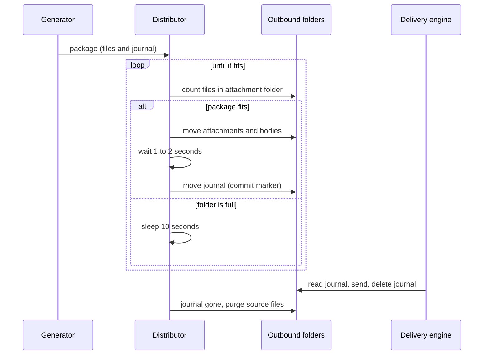

In 2025 I worked on a billing and communications platform for telecom operators. A pipeline of small Spring Batch jobs turns large billing files into PDFs, e-mail bodies and SMS texts, and then hands them to a commercial delivery engine that sends them. This was client work, so I will only describe components and flows, with generic names for everything.

The interesting part is the handoff. There is no broker between the generator and the delivery engine. The integration contract is a set of folders that the engine watches, and almost every reliability property of the handoff had to be built on top of that.

## The contract

The delivery engine watches an outbound structure with separate folders for attachments, HTML bodies, text messages and manifests. I call the manifest the journal: a small pipe-delimited file with a header line and one line per recipient, pointing at the files that belong to each message.

The engine starts sending only when a journal appears. It reads the journal, finds the attachments and bodies it references, sends, and removes the journal. Everything else in this post follows from that one behavior.

I worked on the distribution jobs that fill those folders. They are plain Spring Batch tasklets on Java 8, with no Spring Boot, and a version of them is shared by two clients. The jobs came out of an older family of XML-configured distributors, and some of the ideas below were already there when I arrived.

## Two problems with plain folders

The first problem is half-written files. If the engine sees a journal before the attachments it references are fully on disk, it sends a broken message or fails. Moving a file between folders on the same volume is fast, but a package has tens of thousands of files, and the engine polls independently of my job.

The second problem is overload. The generator can produce packages faster than the engine consumes them. Nothing in a folder tells the producer to slow down, so without a rule the outbound folders just grow.

## The journal as a commit marker

The fix for the first problem is ordering. The job moves attachments and HTML bodies first, waits a short time, and moves the journal last. The engine ignores the folder content until the journal shows up, so the journal works as a commit marker: it says the package is complete.

The wait is a configuration value. It is 1 second in one variant and 2 seconds in another. In the generator's own distribute step, the pause between the two moves is 20 seconds. It is a crude way to be sure the engine sees complete files, and I will come back to what I would do instead.

## Capacity as back-pressure

For the second problem the distribution jobs use the target folder itself as the signal. The job has a maximum package size, 40,000 files in the standard configuration and 20,000 in one other. The free capacity is that maximum minus the number of files currently sitting in the outbound attachment folder.

If a package fits, the job moves it. If it does not fit, the job logs that it is waiting for the delivery engine to send, sleeps for 10 seconds and counts again. A package that is larger than the maximum could never fit, so the job rejects it up front and logs the reason instead of waiting forever.

This is back-pressure without a broker. The engine never talks to the job. Its consumption frees space in a folder, and the job reads that space. The producer slows down when the consumer is slow, which is the property you want from a queue, obtained from a directory listing.

Each distribution type runs with 20 threads, and the capacity check decides how much of that parallelism actually gets used.

## Purge after consumption

The generated PDFs are large and cannot stay forever, but deleting them right after the handoff would break the send. After the handoff the job writes a CSV that maps each journal name to the attachment paths it references. A separate step runs later and checks whether the journal is still in the outbound folder. When it is gone, the engine has consumed it, and only then does the step delete the files listed in the CSV.

A variant for one customer also produces one ZIP per account as a second attachment, and it follows the same rule for the ZIPs.

The consumption signal comes up again in an event-driven consumer I also worked on, where transactional notices arrive from a queue and are turned into the same kind of files. There the consumer moves a text or HTML file plus its journal into the engine folders, then polls the journal folder every 5 seconds for up to 90 seconds. If journals are still there at the end, it records an error saying the journal was not consumed. So "sent" in that flow means "the engine picked it up", and the timeout is a configuration key.

## Reconciliation files

Every step writes a CSV with pipe separators: a header, the step name, an exit code, a message and a timestamp. The distribution jobs also count what went in and what came out. When someone asks where a message went, a count that does not match is the fastest lead.

## Logging in the hot path

One small change made a visible difference. The distributor was writing an INFO line for every file it moved, and with packages this size that line slowed the run down. In March 2025 the per-file logs came out of the hot path, and the project got an asynchronous Log4j2 appender with 10 MB rolling files around the same time.

## What I would change today

The sleep between the two moves is a guess. It works when the pause is longer than whatever the engine needs to see complete files, which makes it a race that happens to be won. Two options would be better:

- write the attachments under a temporary name or in a staging folder, then rename them into place, since a rename on the same volume is atomic;
- have the engine accept a ready marker, so the journal itself is written only after everything else is confirmed.

The capacity count also costs a directory listing every 10 seconds on a folder with up to 40,000 entries. It is cheap enough here, but it is a polling loop pretending to be a queue. A real queue between the generator and the engine would give me both ordering and back-pressure without folder arithmetic. The engine's contract is files in folders, though, so that would have to be a change on their side as well, and I did not have that option.

Until then, the fixed wait is the first thing I would replace.
