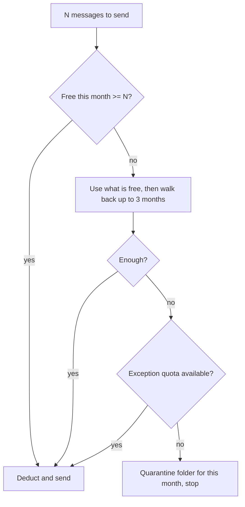

In 2025 I worked on a billing and communications platform for telecom operators, in a pipeline that renders e-mails and SMS messages from billing files and sends them through a commercial delivery engine. This was client work, so I describe only the components and the flow, and I leave out every real number that comes from a contract.

One of the rules in that pipeline is a monthly sending quota per message type. A batch that tries to send more than the quota allows must not send at all. I worked on the notification generator where that rule lives, and the part I like most is how little machinery it needs: a small ledger and a fixed order in which it is consumed.

## The rule in plain words

Each message type has a limit per calendar month. If a month ends with unused quota, that leftover stays usable for a few more months, up to three. If the batch still does not fit, there is a separate pool for exceptions, granted for the current month. If even that is not enough, the generated files do not go out. They are parked in a quarantine folder named after the year and the month, and the run stops.

The message types differ in what they count, for example SMS and several kinds of e-mail, and each has its own limit. I will not say what the limits are, because they are contract values. The algorithm does not depend on them.

## The data

The ledger is a table with one entry per message type and calendar month. Each entry holds the limit for that month and how much has been used so far, and free quota is the difference. A second, smaller table holds the exception grants for a month and a type.

Two properties of this shape help. Past months stay in the table, so "three months back" is a lookup on the same data and needs no separate structure. And every consumption is a plain increase of a used counter, which is easy to inspect when someone asks why a batch was blocked.

## The consumption order

When the insert step knows how many messages a batch is about to produce, it calls the ledger once. The order is fixed:

1. Use the free quota of the current month.
2. If that is not enough, take what is free there and walk back through the previous months, one at a time, up to three, taking unused quota from each.
3. If the batch is still short, look at the exception pool for the current month.
4. If that does not cover it either, quarantine the files and stop.



In sketch form, the core of it is short:

```java
int missing = needed;
for (YearMonth month : currentAndPreviousThree) {
    missing -= ledger.consume(month, type, missing);
    if (missing == 0) return Decision.SEND;
}
return exceptions.cover(currentMonth, type, missing)
        ? Decision.SEND
        : Decision.QUARANTINE;
```

The sketch walks back from the newest month. Which month to drain first decides which leftover expires first, since draining the newest one first lets the oldest run out of window sooner. That is a business choice, and it is worth asking whoever owns the contract instead of settling it in code.

## Counting per batch

The check runs once per batch of messages and not once per message. A batch asks for N units, and the ledger answers yes or no and records the consumption. That keeps the database out of the rendering loop. A per-message check would add a round trip for every e-mail, and for large batches those round trips would be the slowest part of the step.

## Quarantine and reprocess

A blocked batch does not delete anything. The generated files go to a folder named after the year and month, so an operator can see what was held back and for which period, and the files stay available if the quota situation changes.

The same job has a reprocess mode. When a run finds no new input file, it can look for records that did not finish, put their source file back in the input folder and process them again. If the earlier failure was that the delivery engine was offline, it stops instead of trying.

## What breaks

I found three weaknesses when I read the code closely, and I think they are the useful part of the story.

The first is concurrency. The update reads a counter, adds to it and writes it back, with no lock and no conditional update. That is fine as long as one job runs at a time. If two customer profiles ever ran the same step at once, both could read the same free quota and both could spend it. An atomic update that fails when the free quota is too low would fix it, and it is a small change.

The second is the window. Three months is hard-coded. A contract that changes it means a code change and a deploy.

The third is the position of the check. It runs after the files have been rendered, so a blocked batch has already paid for the composition engine. Checking before rendering would save that work, but it would need the message count earlier in the pipeline than it is available today.

## Tests I would want

The unit tests I would write first are about the boundaries of the order:

- exactly enough free quota in the current month, and one message more than enough;
- a current month with zero free quota and a previous month that has some;
- unused quota in a fourth month back, which must be ignored;
- a batch covered only by the exception pool;
- a batch that nothing covers, with the files ending up in the right quarantine folder.

There is one rule I could not confirm from the code and would want written down and tested: what happens to the counters already decreased when a sequence ends in quarantine. If the deduction is not rolled back, a blocked batch would consume quota without sending anything.
