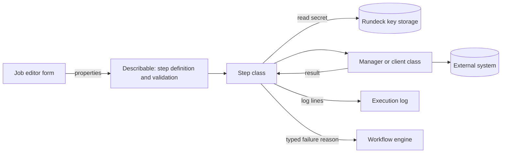
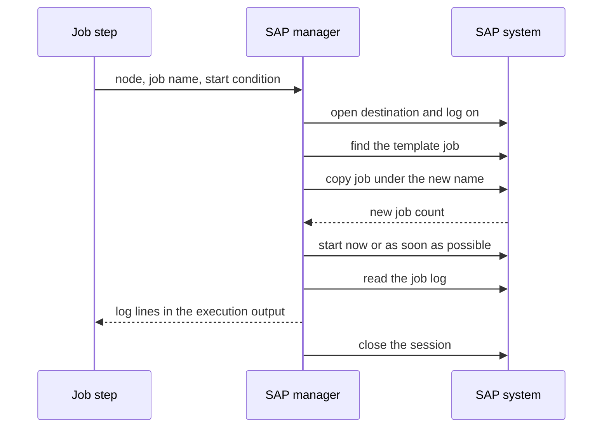
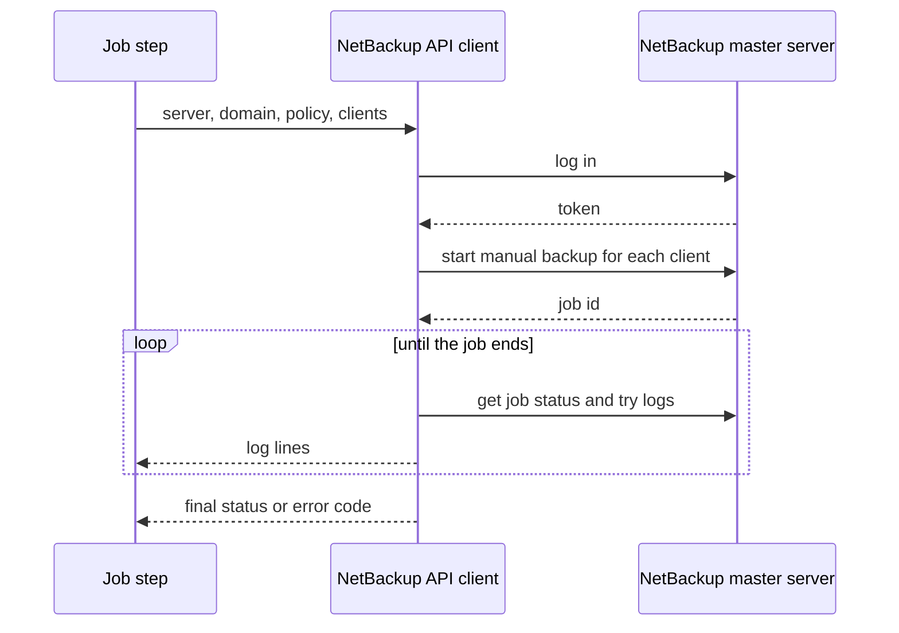
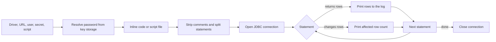
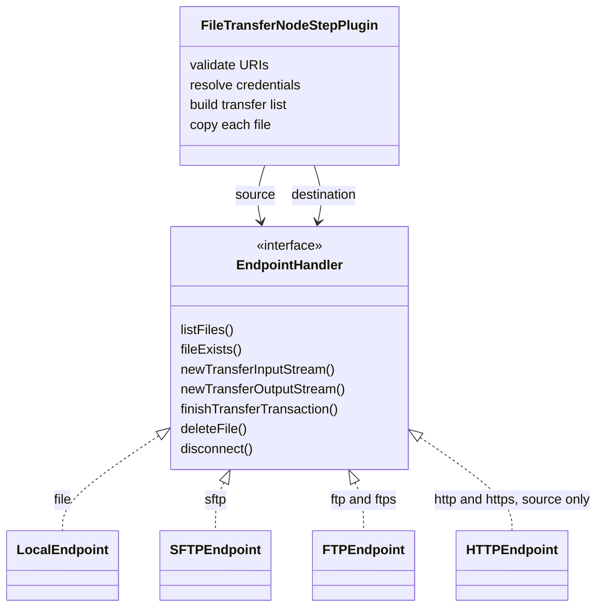

A scheduler is only as useful as the systems it can reach. QWControl runs on Rundeck's plugin model, so each external system gets a plugin, and each plugin shows up in the job editor as a new step type. I built these between 2022 and 2024, before and during the move to the [modular platform](/work/qwcontrol-modular-platform/). The diagram above shows how a job step reaches each system.

## One shape for every plugin

All of them follow the same pattern. A describable class declares the step and its properties, which gives the job editor its form and its validation. A manager or client class owns the connection to the outside system. The step class reads the configuration, asks the manager to act, writes to the execution log and turns failures into a typed step failure.

Secrets never live in the step definition. A password or a private key is a path into Rundeck's key storage, and the step reads it only when it runs.

## SAP

The SAP plugin talks to SAP through the JCo connector and SAP's background processing interface. It exposes eight steps: create, copy, run and monitor a job, run a batch input session, manage an interception or event history profile, and trigger or monitor a background event. A ninth piece is a resource model source that turns an SAP system into a QWControl node, so SAP hosts appear next to Linux and Windows machines.

The step that gave the plugin its purpose is copy and release. A team keeps a template job in SAP, and the step copies it and starts the copy.

Connection settings such as language, system number and the size of the connection pool come from project properties, so one QWControl project can point at one SAP landscape.

## NetBackup

The NetBackup plugin has four steps: create, copy, delete and run a policy. It uses NetBackup's REST API. The run step can start one backup per client and then follow the job until it ends, printing the try logs into the execution output.

## SQL Script

One node step runs a SQL script over JDBC. The driver is a list in the form, and the plugin bundles drivers for Oracle, SQL Server, DB2, MySQL and a MongoDB JDBC bridge. The script can be typed inline or read from a file on the server. The plugin removes comments, splits the script into statements and runs them one by one. Queries print their rows into the execution log, and other statements print how many rows they affected.

## File transfer

The file transfer plugin moves a file between two endpoints, or from an endpoint to a QWControl node. Each side is a URI, and the scheme picks an implementation of one small interface that lists, opens, writes and deletes files.

The step validates both URIs before it touches the network. A wildcard is allowed only in the source file name, and then the destination must be a folder. After that it connects both sides, builds the list of files, and streams each one from the source to the destination without writing a temporary file. Optionally it deletes the source afterwards.

SFTP uses SSHJ, with host keys checked against the known hosts of the installation. FTP and FTPS use commons-net, with explicit and implicit TLS and a switch for self signed certificates. Local files and an HTTP source complete the set. There is also a mode that copies the source stream straight to a node using QWControl's own file copier.

**z/OS.** Support for mainframes came through the FTP endpoint, and it needed two details. A dataset name between single quotes is passed through as a dataset, not as a path. And each URI can carry its own character set, so a file leaves a Linux server in UTF-8 and lands in the mainframe in an EBCDIC code page, or the other way around.

## Sleep

The smallest plugin waits for a duration before the next step. The value can be seconds, minutes or hours, such as `90`, `15m` or `2h`, and the form validates it before the job starts.

## Rule Flow

The strategy plugin that decides when each step runs has its own page, with the editor: [Rule Flow Strategy and Visual Editor](/work/qwcontrol-rule-flow-editor/).

## VMware and Proxmox

The VMware plugin manages virtual machines from a job step. Its dashboard grew into a separate module and has its own page: [VM Dashboard Monitor](/work/vm-monitor-dashboard/).
