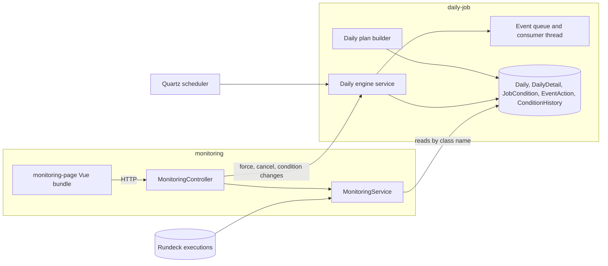
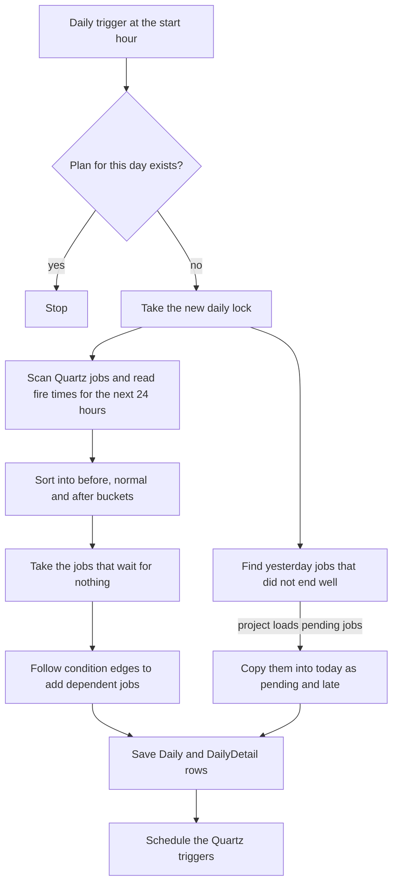
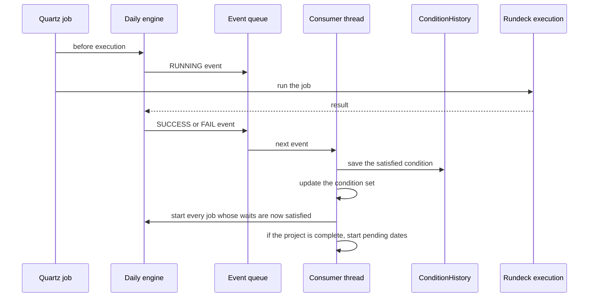
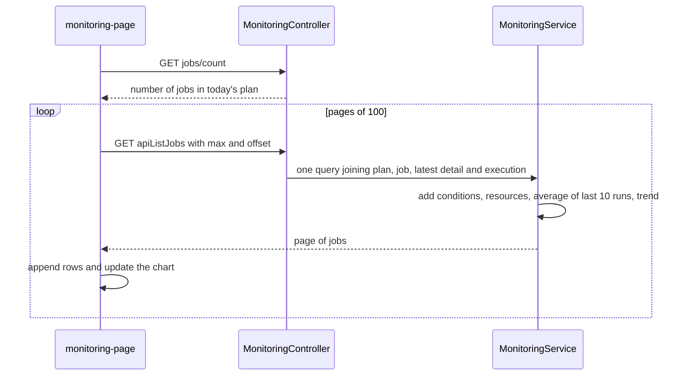
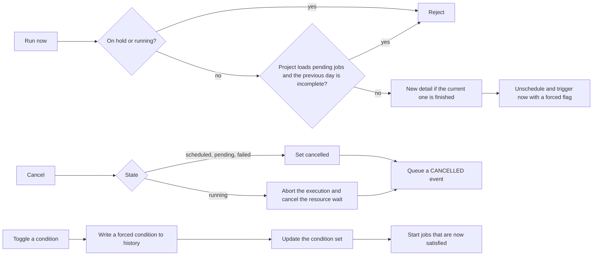

Batch operations teams start the day with one question: did last night's jobs finish, and what is still waiting. Two modules answer it. The daily job module is the engine that builds the plan and releases each job when its conditions are met. The monitoring module is the board that shows the plan and lets an operator act on it. I wrote a large part of the board and moved its interface into the shared `spa-ui` package, so it follows the look of the rest of QWControl.

The screenshot above is the real interface running against fake jobs.

## Two modules, one plan

The monitoring module owns no tables. It reads what the daily job module stores, and it reaches that module by class name, not by import, so each can be built alone.

## How a day is built

The daily module replaces the scheduling manager of the core. A job no longer runs because its cron time arrived. A job is part of a daily plan, a business day that starts at a configured hour, and it runs when the plan says it can.

Two Quartz triggers drive the plan. One fires at the start hour and builds the day. The other fires three minutes earlier and prepares the jobs that belong before the start.

A job with a before or after calendar from the [calendar module](/work/qwcontrol-platform-modules/) shifts its order date by one day, which is how the three buckets come to exist.

## Conditions release jobs

Dependencies between jobs are stored as conditions. An edge from job A to job B means that A publishes a condition when it succeeds and B waits for it. A condition is satisfied when it is in an in-memory set. A plus sign adds a condition to the set and a minus sign removes it.

A single consumer thread processes the events, so condition changes never race. The history table makes the state replayable: when the engine starts, it rebuilds the condition set from it. Jobs that were running with no end time when the server stopped are marked as failed by the recovery step.

Rules can also react to events, such as running another job on failure or setting a variable. The status of a day entry is one of scheduled, pending, running, succeeded, failed, aborted, timed out, rescheduled, cancelled or waiting for a resource.

## What the board shows

Four counters sit at the top: succeeded, failed, running and pending, each with a total and a percentage of the day. Below them a table lists the jobs with status, duration, tendency compared with the average run time, scheduled time and order. Columns can be filtered and sorted, and pagination keeps long days manageable.

The tendency comes from the last ten runs of the job. The backend compares the latest duration with their average and reports it as increasing, decreasing or steady.

## Loading the board

A busy day can have many entries, so the page loads them in batches of one hundred.

The query joins the plan, the job, the latest detail of each entry and its execution in one statement. The extras, such as conditions and resources, are still fetched for each row, which is the cost of showing so much per line. The table component loads asynchronously, and the bundles were trimmed so the page opens quickly. Refresh is manual, through the refresh button.

## Acting on a job

Each row has buttons to run a job now, open the log of its execution, reschedule it and cancel it. The expand button opens the dependencies of a job. It lists the conditions a pending job is waiting for and the resources it needs, and lets someone mark a condition as satisfied or force a resource by hand when the outside world has already done the work.

Forcing a condition leaves a record with a forced flag, so the history shows what a person did by hand and what the engine did itself.

## Related

Monitoring is one of the modules extracted in the [modular platform](/work/qwcontrol-modular-platform/) work. The [calendar and licensing modules](/work/qwcontrol-platform-modules/) sit next to it.
