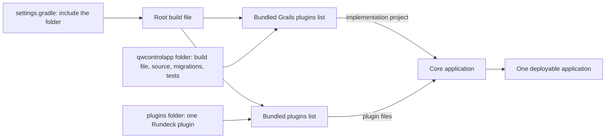
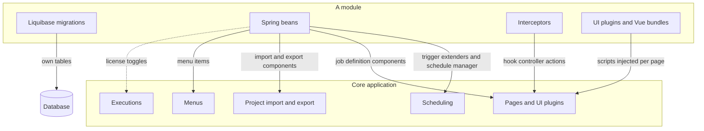

QWControl is a commercial workload automation platform from QW Software, in the same market as Control-M, built on top of Rundeck. I worked on it from March 2022 to November 2024. In the beginning, every feature the product added lived inside the Rundeck code. I led the work that pulled those features out into their own modules, and `qwcontrolapp` is the folder where they live now. The product belongs to the company, so this page stays at the level of modules and flows.

There is a longer write-up on the [blog](/blog/modularizing-qwcontrol/). This page is the short version.

## The problem

With everything in one tree, features shared the same build and the same release. A change to the calendar sat next to a change to the VMware screens, and neither could be built or tested without the rest.

## What changed

The core application stays a Rundeck-based app. Anything QWControl adds is now a Grails plugin with its own folder, build file and tests, and the core loads them as bundled plugins. The diagram above shows the layout before and after.

Two kinds of pieces came out of it:

- Modules under `qwcontrolapp/`, which add platform features such as the UI, calendar, licensing, monitoring and the VMware integration.
- Plugins under `plugins/`, which add job steps and strategies such as SAP, NetBackup, SQL scripts and file transfer.

## How the build loads a module

The main build file declares two lists. One names the Grails modules and the other names the Rundeck plugins. The application project reads the first list and adds each entry as a dependency, and it packages the second list as plugin files.

Adding a module means creating its folder, including it in the settings and adding a line to the list. A module that is commented out of both places, as the node monitor is today, disappears from the build without touching anything else.

## What a module can do at runtime

A module is a Grails plugin, so at startup it can register beans, menu items, interceptors and database migrations. It reaches the behavior of the core through extension points that Rundeck already has, so the core does not know the module exists.

The [platform modules](/work/qwcontrol-platform-modules/) page goes through the main ones and what each hooks into.

## How it happened

I did it in steps over a few weeks in late 2023. Calendar, monitoring, interactive node, resource manager, license, UI enhancements and rule flow were extracted first, each into its own module. On 24 November the module builds moved into the main bundled plugins configuration, and on 27 November a single commit moved the remaining files into `qwcontrolapp/`. New modules, like the VMware one in 2024, started life already in that shape.

## Result

A feature now has an owner folder. The license module can decide which of them an installation may use, and a new integration is a new plugin instead of a change to the core.

## Related

- [VMware dashboard](/work/vm-monitor-dashboard/)
- [Integration plugins](/work/qwcontrol-integration-plugins/)
- [Platform modules](/work/qwcontrol-platform-modules/)
