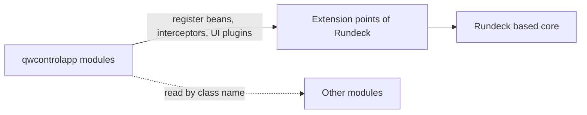
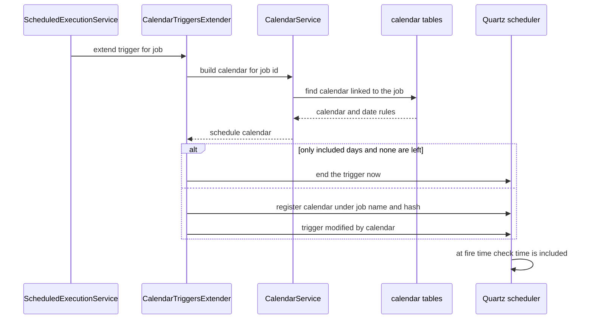
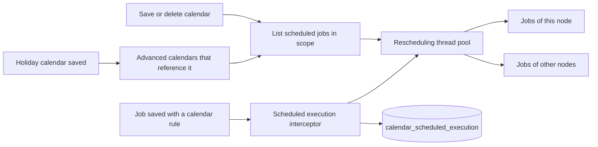
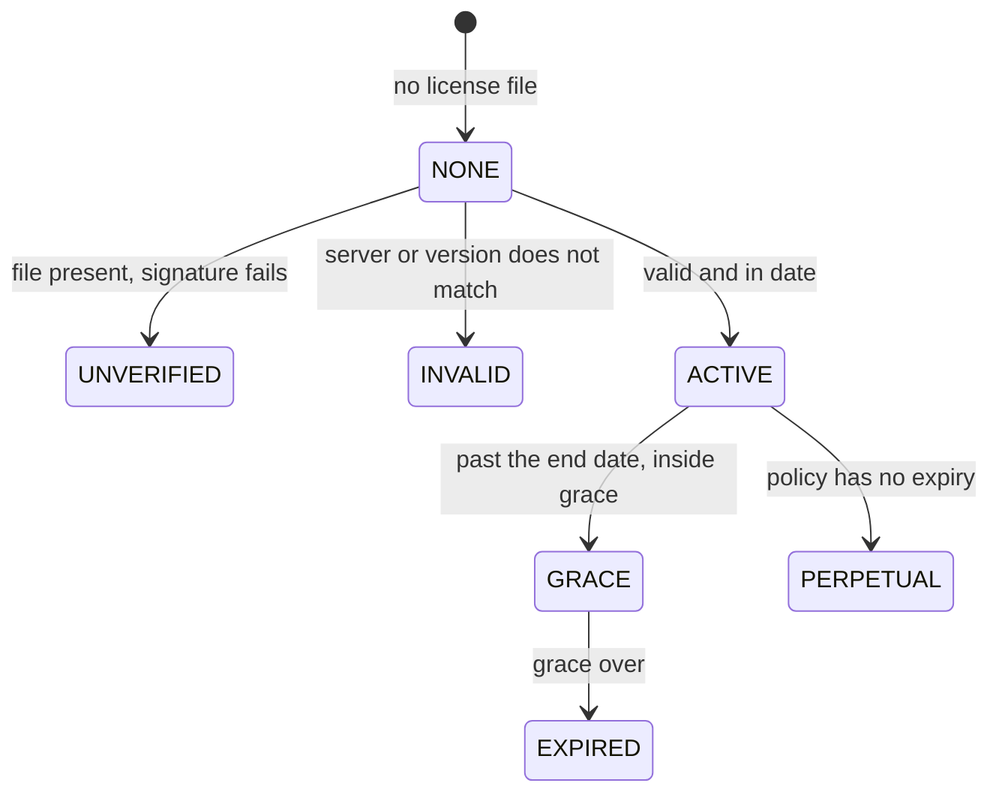
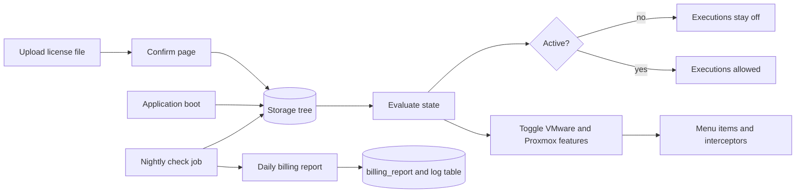
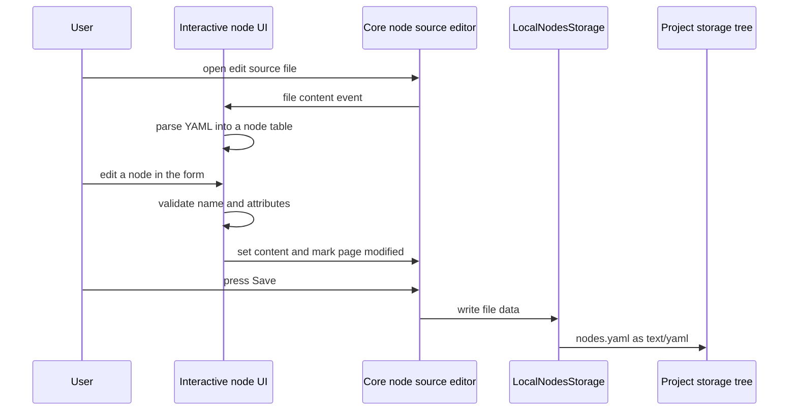
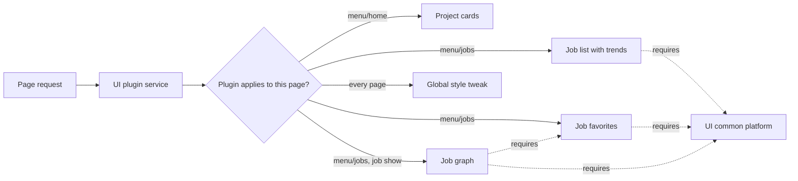
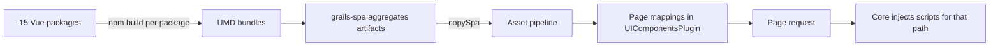
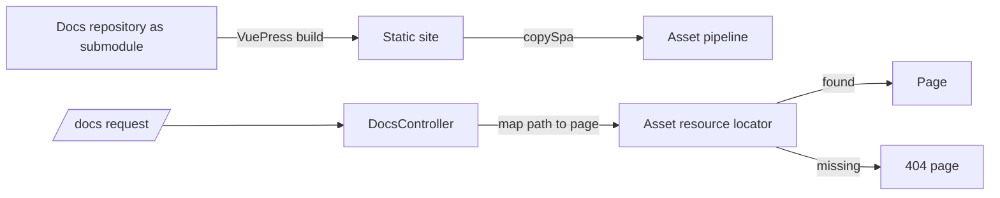

Besides the plugins and the big dashboards, QWControl has a set of modules that make it behave like one product. Each one is a folder under `qwcontrolapp/` with its own build, as described in the [modular platform](/work/qwcontrol-modular-platform/) page. This page shows how each module attaches to the Rundeck core and what happens at runtime. The diagram above groups them by what they do for the platform.

## How modules talk to the core and to each other

A module is a Grails plugin. It reaches the core through the extension points Rundeck already has: trigger extenders, job definition components, project import and export components, menu items, interceptors and UI plugins. The core never imports a module.

Modules also avoid compile time links between themselves. The monitoring module reads the daily plan by class name, and the reports module reads tables from the license module the same way. A module can be left out of a build and the rest still compiles.

| Module | What it hooks into |
| --- | --- |
| calendar | trigger extender of the scheduler, job definition component, project import and export, menus |
| daily-job | replaces the schedule manager, Quartz listeners, job definition component, interceptors |
| license | storage tree for the license file, the executions active flag, feature toggles, menu, UI plugin |
| monitoring | system menu item and a UI socket |
| interactive-node | writable resource model source, project import and export, storage tree |
| enhance-ui | five UI plugins |
| spa-ui | one UI plugin with page mappings for 15 Vue bundles |
| docs | an asset backed controller |

## Calendar

The calendar module decides on which days a scheduled job may fire. An admin defines a calendar for the whole system or for one project. A calendar has a type (included, excluded, before, after or holiday) and a date type (single date, range, daily, weekly, monthly or advanced). An advanced calendar combines weekdays, days of the month, months and holiday calendars.

The part that makes it work is a trigger extender. When the core builds the Quartz triggers of a job, it calls every extender, and the calendar one turns the saved calendar into a Quartz calendar attached to the trigger.

The register name has a hash of the calendar contents, so editing a calendar creates a new registration instead of mutating the old one. The module also patches the next run time calculation, so the "next execution" the interface shows already respects the calendar.

Saving a calendar triggers a reschedule of every job that uses it, on a thread pool. In a cluster, jobs owned by the local node go first. Saving a holiday calendar reschedules the advanced calendars that reference it.

Data lives in two tables: `calendar`, with the type, the date definition as JSON and the scope, and `calendar_scheduled_execution`, which links one calendar to one job with two rules, one for the calendar and one for the execution day. Project export writes the calendars into the project archive, and import matches them by name. There is a REST API at project and system level, and the Vue widgets for the screens live in `spa-ui`.

## License

The license module controls what an installation may do. It keeps the license file in a database backed storage tree, not on disk, and migrates an old file into it on first start. The state of the license drives the application.

The check runs at boot and every night. A license has to name the server it runs on, or allow any server, and it has to match the application version. When the state is not active, the default policy puts the application in passive mode, and the module overrides the execution service so no new executions start.

The license also lists the licensed modules. For each enterprise feature, VMware and Proxmox today, the module flips a feature toggle that the other modules read. The virtual automator checks that toggle in its interceptors and in its menu items, so an unlicensed feature disappears from the menu and its endpoints answer 404.

The nightly job also writes a billing report: how many executions ran, how many distinct jobs, and how far that is above the number of licensed jobs. The report only reports. It does not block anything.

The module also ships a UI plugin, the common platform, that carries shared scripts and styles. The enhance-ui plugins declare it as a requirement, so the core loads it first.

## Daily job engine

The daily job module is the scheduling engine behind the [monitoring board](/work/qwcontrol-job-monitoring/), so its design is on that page.

## Interactive Node

An editor for the nodes of a project inside the interface. It is a Rundeck resource model source named `interactive-node` that can be written to, and its data is one YAML file in the project storage tree. The Vue interface shows the file as a table and a form, next to the stock editor.

The table is a view over the YAML. The raw editor tab stays authoritative, and nothing is validated on the server beyond what the core already does. Project export includes the node files, and import recreates the node source in the project properties when it is missing.

## UI Enhancements

A front end only module. It has no tables and no endpoints. It registers five UI plugins that the core injects by page.

Project cards replace the stock project list. The job list adds a table column with the trend of recent runs and a forecast icon. Favorites are saved with the user settings of the core, so they follow the user across machines. The job graph draws the dependencies of a job with dagre.

## SPA UI

The shared package holds the Vue interfaces of the other modules. Each package is built as its own UMD library, and the build collects them into the plugin assets.

At runtime a bundle attaches to the page in one of three ways:

- It registers a widget in a UI socket, a named place in a page that the core renders, as the monitoring, VMware, Proxmox and node editor screens do.
- It injects itself into the DOM, as the calendar, event action and resource tabs of the job editor do.
- It uses a helper from the common platform, as the daily job graph does for its tab.

Two bundles load on every page. One replaces the navigation and offers the system, light and dark themes. The other translates the stock Rundeck screens into Portuguese by matching elements, since those pages have no hook for messages. Each of my packages has its own language files and reaches the backend through the Rundeck client.

Each bundle ships its own copy of Vue and its libraries. That costs download size, and it is the reason the mapping of bundles to pages matters: a bundle loads only on the pages where it works. A new package needs a Gradle project, an artifact line in the aggregator and an entry in the page mappings. 175 of my commits touch this module.

## Documentation

The `docs` module serves the product documentation from inside the application, under `/docs`. It has no tables. The pages come from a separate documentation repository, built with VuePress and attached as a git submodule. The Gradle build bundles the module only when the submodule is present.

## Node Monitor

A node health module existed too, and it is worth a line because it shows how a module can be retired. It checked every node of every project every 30 seconds by running a short command, and kept the last status per node. It became a module in January 2024 and was renamed from a network nodes module. It is switched off in the current build, and a few reports still read its table.
