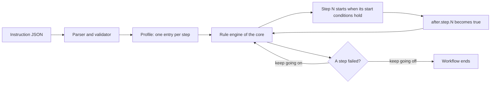
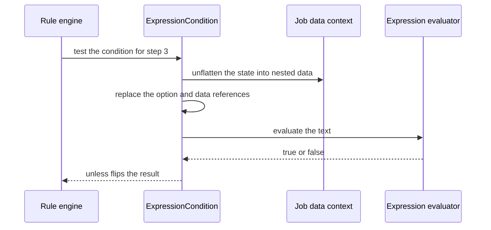
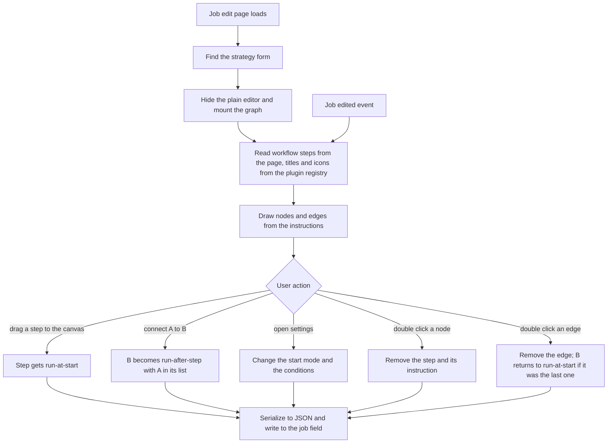

A normal job workflow runs its steps from top to bottom. Batch processes often need more: a file transfer that waits for a row count, or a retry that only runs when the check fails.

The Rule Flow strategy plugin lets a job describe those relations as rules. I worked on the plugin and wrote the visual editor that sits on top of it.

## Rules behind the graph

Each step in the workflow gets an instruction: `run-at-start`, `run-in-sequence` or `run-after-step`, the last one naming the steps it waits for. Any instruction can also carry conditions, written as `if` and `unless` expressions over the job context. A step with no instruction runs in sequence, after the step before it.

The instructions are one JSON document saved in a field of the job. Keys select steps by number, as a single step, a list or a range, and a star selects all of them. The editor also stores the position of each node, which only the graph uses.

## How the strategy runs a job

The plugin does not run steps itself. It plugs into the rule engine that the core already uses for workflows, and it only translates each instruction into a start condition for the engine. A step starts when its conditions are true.

What each instruction becomes:

| Instruction | Start condition in the engine |
| --- | --- |
| `run-at-start` | the workflow has started, so these steps begin together and run in parallel |
| `run-in-sequence` | the previous step has finished |
| `run-after-step` | every listed step has finished |
| `if` or `unless` | an expression is true, or false for `unless` |

Parallelism is a consequence, not a setting. Two steps that wait for the same condition start together, and the engine has no thread limit of its own. Failure handling belongs to the core: unless the job keeps going on failure, the workflow ends at the first failed step.

A condition is evaluated against the data of the running job. The engine builds that state from the options and from the output of earlier steps. The plugin replaces the variable references in the expression with their values and passes the text to a small expression library that returns true or false.

## Validation

The plugin validates the JSON when the job is saved. It reports invalid JSON, a directive it does not know, a step selector it cannot read and a `run-after-step` with no usable list, with the step and line in the message. The editor sits on top of that, so a mistake made in the graph cannot produce an invalid document in the first place.

## The editor

Writing that as JSON works, but nobody enjoys it. The editor draws the workflow as a graph. Steps that are not placed yet wait in a palette on the right, you drag them onto the canvas and connect them, and the editor writes the instructions for you. Loading a job reads the instructions back and rebuilds the graph, including node positions. The screenshot above is the real editor, running on fake steps: five are connected and two still wait in the palette.

The editor is a Vue component built on Vue Flow. It mounts inside the job editing page, in place of the plain instructions field, reads the steps from the page itself and keeps the field in sync.

When steps are added, removed or reordered in the normal editor, the page raises an event and the graph refreshes its nodes.

## Conditions

Selecting a step shows a settings button that opens its configuration: the start mode and a list of conditions. A step can have several conditions, and each one is either `if` or `unless`.

## Where it fits

Any step type can sit in the graph: a SQL script, a file transfer, an SAP job or a sleep. Rule Flow belongs with the [integration plugins](/work/qwcontrol-integration-plugins/), and it was one of the first pieces extracted in the [modular platform](/work/qwcontrol-modular-platform/) work.
