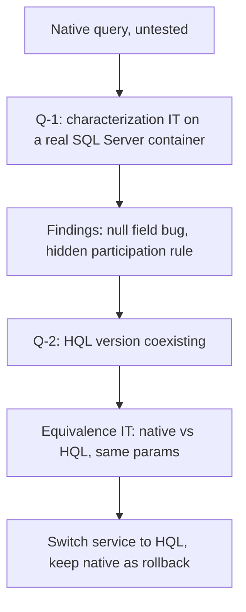

This was client work for a health plan operator in Brazil, so I only describe components and flows. The component here is a telehealth scheduling API, and the problem was its provider search: a native SQL Server query of 334 lines with 8 CTEs. Nobody wanted to touch it, and the reason was reasonable. No test ever executed it.

I needed to move it to HQL as part of a larger cleanup, and I did not want to find out in production that I had changed a business rule. This is the sequence I followed.

## Why nobody wanted to touch it

The query was a native `@Query` with two near-identical texts, `value` for the page and `countQuery` for the total. Whenever two texts have to stay in sync by hand, they drift. The team had already paid for that once: a previous bug where the count query diverged from the main one inflated the total, and the last page came out incomplete. In a sibling service, the count query used `IS NULL` where the main one used `IS NULL OR = 0`, so a sentinel value of 0 made the count return 0 and the service threw "no records" even though results existed.

Unit tests with mocks would prove nothing here, because the logic lives in the SQL. The tests had to run the query on a real SQL Server.

## Characterize first

Step one changed no production code. I added Testcontainers with a SQL Server image (running on Podman) and separated the integration tests from the fast suite: they run with the failsafe plugin, so `mvn test` stays quick and `mvn verify` starts the containers.

The query touches 17 tables. I built a minimal schema for those 17 and 26 fixture providers, each one existing to exercise exactly one business rule: exclusions, a restricted network in both directions, accent-insensitive name matching, an expired specialty, a cancelled address, and so on.

Writing the fixtures taught me things the query never said out loud. One expression computed a billing indicator, and a later filter required that indicator to equal 0. Reading it, I assumed the billing event only affected ordering. The fixtures showed that having a matching billing event was a mandatory condition to appear at all. Nobody had written that down as a rule. It was a side effect of an expression and a later filter.

## What the characterization found

It also found a production bug. The final SELECT never exposed the city column that the projection expected, so the city field was null in every provider returned by the endpoint. Nothing failed, because null is a valid value. I fixed it in both query texts and added a test.

I would not have found this by reading the query. I found it because a test asserted on the response and the response disagreed.

## Translating to HQL

The HQL version needed 7 new JPA entities. Only 10 of the 17 tables were mapped, and I mapped each new one minimally, with just the columns the query touches. The 8 CTEs collapsed into one flat HQL using `EXISTS` and correlated subqueries.

Some constructs have no direct equivalent, so each translation was a decision:

- `WITH (NOLOCK)` was dropped, since HQL has no portable equivalent;
- the accent-insensitive `COLLATE` became `translate()` applied on both sides of the comparison;
- `ROW_NUMBER() ... rn = 1` became a correlated `MIN()`;
- `SELECT TOP 100` became `PageRequest.of(0, 100)` plus slicing;
- a redundant computed column was removed.

Dropping `NOLOCK` is the one I would flag. It changes locking behavior, not results, so the equivalence tests cannot see it. The dialect translations are documented for that reason.

## Proving equivalence

The new HQL lives next to the native query. An equivalence integration test runs both on the same parameters and the same fixtures and compares the results. It ended with 16 tests green: 8 from the characterization and 8 new ones.

Then production switched to HQL. The method keeps the same 8-parameter signature, so the change in the service is mechanical. The native query stays untouched as a reference, which gives a simple rollback path: point the service back at the old method.

## Making sure the tests can fail

Green tests tell you little until you have seen them go red. During review I ran mutation checks by hand. I broke one condition in the HQL, and the tests that run the HQL version failed, 8 out of 8, while the native query stayed correct. I renamed the HQL method, and compilation failed in exactly one place, the service, which proves production really uses the new method and not a leftover.

## Risks I wrote down

The commit has a risk register, because some things are guesses. There are no schema docs for these tables, so the column names of the 7 new entities were inferred from the query text, and the primary key names of 3 tables were inference too. The datasource runs with `ddl-auto: validate`, so a wrong name fails loudly at boot and does not corrupt anything silently. I accepted that because a failure at startup is the cheapest kind.

The whole exercise cost more than a direct rewrite would have. The Testcontainers setup, a schema of 17 tables and 26 fixtures are a lot of scaffolding for one query. In return, the provider search now has a test for each business rule, and two versions that must agree. The `NOLOCK` change and the inferred column names are the two things I would still watch after deploying.
