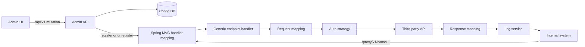

This was client work for a health plan operator in Brazil, so I will only describe components and flows. The problem was familiar: internal systems kept needing data from third-party APIs, and every integration meant a code change in some system plus a deploy. Each system also handled authentication, field mapping and logging on its own, in its own way.

I built a proxy to take that over. Consumers call `/proxy/{version}/{name}/...`, and the proxy calls the real target with central authentication, field mapping, auditing and logging. Product can add a new integration without waiting for a release, because an integration is configuration stored in a database. The stack is Java 21, Spring Boot 4.1 and SQL Server, with about 170 main classes.

## The data model

The model has about ten tables. A proxy has endpoints, each endpoint has mappings and optional steps, and each endpoint points to a target service with an authentication configuration. Around that there are tables for change history, tokens and path variables.



The request goes through the JWT check, the dynamic handler, the request field mapping, the authentication header for that target, the outbound call, the response mapping and the log service, which records the request and response pair before the caller gets its answer.

## Registering routes at runtime

There is one generic handler class. At startup the application loads every proxy in test or published status, and each endpoint becomes an entry in Spring MVC's `RequestMappingHandlerMapping`. When someone changes an endpoint through the admin API, the route is registered or removed right away, with no restart.

```java
RequestMappingInfo info = RequestMappingInfo
    .paths("/proxy/" + version + "/" + name + route)
    .methods(RequestMethod.valueOf(method))
    .build();

handlerMapping.registerMapping(info, handler, HANDLE_METHOD);
registry.put(endpointId, info);
```

There is a trap here. If you remember a route by its name and version and someone renames the proxy, you can no longer find the old mapping, and the old URL would keep answering. So the registry keeps the `RequestMappingInfo` by endpoint id. To remove a route I take it from the registry and unregister that exact object, whatever the endpoint is called today.

The handler holds no per-request state. A hot reload builds a fresh handler, because mappings, path variables and steps are loaded when it is constructed.

I also had to split the URL space. Early on, dynamic routes lived under `/api/...`, next to the admin API, and a proxy named like an admin resource could collide with it. I made a breaking change: dynamic traffic lives under `/proxy/**` and the admin API under `/api/v1/**`. The two never overlap.

## Guardrails

Letting people create routes from a form needs rules, or the form becomes a way to break production.

A proxy goes through a lifecycle: drafting, test, published, inactive. In drafting it is editable and its routes are off. In test it is editable and its routes are on. Published is frozen: you cannot edit or delete its endpoints, only add new ones. Publishing records the environment, homologation or production, and once something is published to production it cannot go back to drafting (the API answers 409). Deleting a draft is a hard delete, and deleting a published endpoint only marks it inactive.

The test stage came late, in October. For a while the only choices were a draft with no routes or a frozen published proxy, which made it hard to try a change against a real route. Adding it exposed a bug: in test mode some endpoints were skipped because a "published" flag was false. The fix was to persist the flag and re-register the endpoint with the updated proxy reference.

Audit is automatic. An event handler writes the change history after the transaction commits, so no service has to remember to call it. The user always comes from the JWT, never from the request body.

Credentials are write-only. The admin API accepts them and stores them encrypted, and no GET returns them, only a boolean saying whether they are set. Export and import move a proxy between environments as a snapshot (endpoints, path variables, mappings, steps) without credentials. On import, services are matched by company name, and existing ones are reused.

The proxy also protects itself:

- an optional per-proxy rate limit, counted per window, which answers 429 in the standard error envelope and is off when set to 0;
- a 5-minute Caffeine cache for endpoint, mapping, active-token and reference lookups, evicted immediately on writes;
- names, endpoints and steps restricted to a safe character set, and duplicate method plus route combinations rejected.

For the OpenAPI contract, the pipeline exports the spec by booting the application with a profile that needs no database.

## What I would do differently

Three things bother me.

First, changes made directly in the database only apply at the next boot, while changes through the API apply immediately. I wrote that down in the docs, but it is the kind of rule that someone will forget during an incident.

Second, import does not carry authentication. Promoting a proxy from homologation to production by import works, but someone must link the credentials again by hand.

Third, the admin portal has no automated test suite yet. The backend has about 65 test files, and the portal relies on the backend validating everything. I would rather have tests on the mapping editor.
