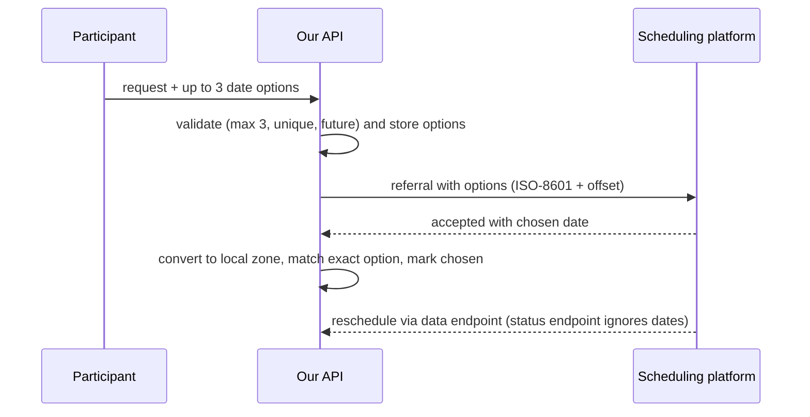

This was client work for a health plan operator in Brazil, so I only describe components and flows. The service is a telehealth specialist-referral API. A participant asks for an appointment, the system sends a referral to an external scheduling platform, and the platform calls back when the appointment is accepted, rescheduled or changes status.

The feature I added was simple to describe: let the participant propose up to 3 date options, and send them along with the referral. I wrote the integration contract for the partner myself, and a good part of that document is about things that fail without anyone noticing. This post covers three of them.



## An additive field

The contract adds no new endpoints. The referral payload gets one optional array with 1 to 3 options. Each option has an order, which carries the participant's preference, and a date time in ISO-8601 with an offset.

```json
{
  "scheduleOptions": [
    { "order": 1, "dateTime": "2026-10-05T14:30:00-03:00" },
    { "order": 2, "dateTime": "2026-10-06T09:00:00-03:00" }
  ]
}
```

The detail that mattered most is what happens when there are no options. The key is absent. It is not an empty list and it is not null. A partner whose parser requires the key breaks on every referral that has none. The contract says so in plain words, because a field is only additive if the old payload shape stays valid.

Order is an explicit field, so preference does not depend on array position.

Validation happens on our side, before sending: at most 3 options, no duplicates, none in the past. A request that breaks those rules is rejected before anything reaches the partner.

## The time zone bug

All dates are converted to America/Sao_Paulo wall time. That rule exists because of an earlier bug. A piece of code called `toLocalDateTime()` on the incoming value, which discards the offset. A payload with 14:30Z was stored as 14:30 local time, three hours off. It only showed for payloads that did not already use the -03:00 offset, and the consequence was that option matching failed, as I describe below.

The fix is a small value object that owns every time zone conversion. Parsing, converting and formatting happen in one place, and nothing else in the service touches a zone.

The contract tells the partner something awkward: if you built a workaround for our bug, remove it with this release. A compensation on their side plus a correction on ours would shift every date by the same three hours in the other direction.

## Matching the chosen option

When the platform accepts an appointment with a date, the system looks for an option that equals that date to the minute, after conversion, and flags it as chosen. A table with one row per option stores the order from 1 to 3, the date time, the chosen flag and a creation time, with at most one chosen per appointment.

Here is the trade-off I made on purpose. When no option matches, it is not an error. The scheduling proceeds, the response is 200, and the divergence only appears in the internal history. A divergence from what the participant proposed should not block an appointment the platform has already confirmed.

The cost is that a time zone mistake no longer looks like an integration failure. It looks like a participant who chose none of their options. The information is lost silently, and the spec says so explicitly, because a trade-off nobody wrote down turns into a surprise later.

## Endpoints that look the same

The platform calls back on three endpoints, and they are not interchangeable. One of them only updates the status. If you send it a date, it ignores the date and answers 200. Only the endpoint for updating data rewrites the schedule. The contract calls this out as the most common integration error, because from the sender's side everything looks successful.

A reschedule also requires the id of the accepted provider along with the new date. Without it, the answer is 400. That one at least fails loudly.

For now the rule lives in the documentation. I would rather it lived in the API, with the status endpoint rejecting a date it is going to ignore.

## Testing for the zone

The machines running the tests were already in the right zone, so the code behaved the same whether it used the zone from the value object or `ZoneId.systemDefault()`. No test could tell them apart.

The fix is to force a different default zone inside the test, with `TimeZone.setDefault(UTC)`. A `-Duser.timezone` argument in Maven does not help here, because it does not propagate to the Surefire fork, so the test has to set the zone itself.

With that in place, replacing the value object by a call to the default zone makes the tests fail, which is what I wanted to see before trusting them.

The same issue appears outside this feature. A nightly export job names its files with a date, and the container runs in UTC. A plain `LocalDate.now()` at 01:00 would return the next day, so the job resolves the date in the São Paulo zone explicitly.

## What I would still change

Matching to the exact minute is strict. If the platform rounds or truncates a time, an option will not match and only the history will show it. I have no evidence that this happens. I would add a metric on unmatched options before adding any tolerance, since a tolerance would hide the mismatches I want to see.
