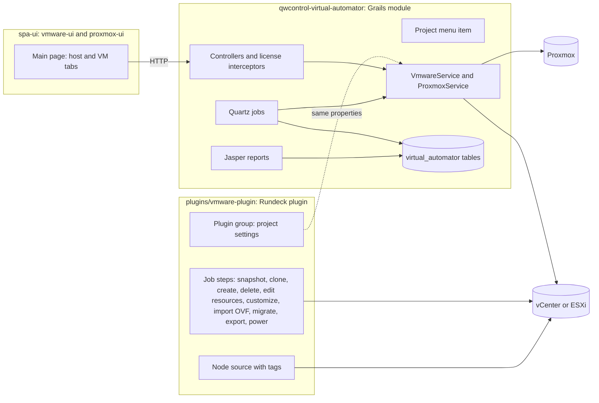
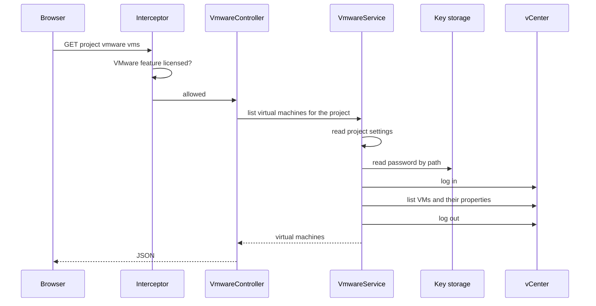
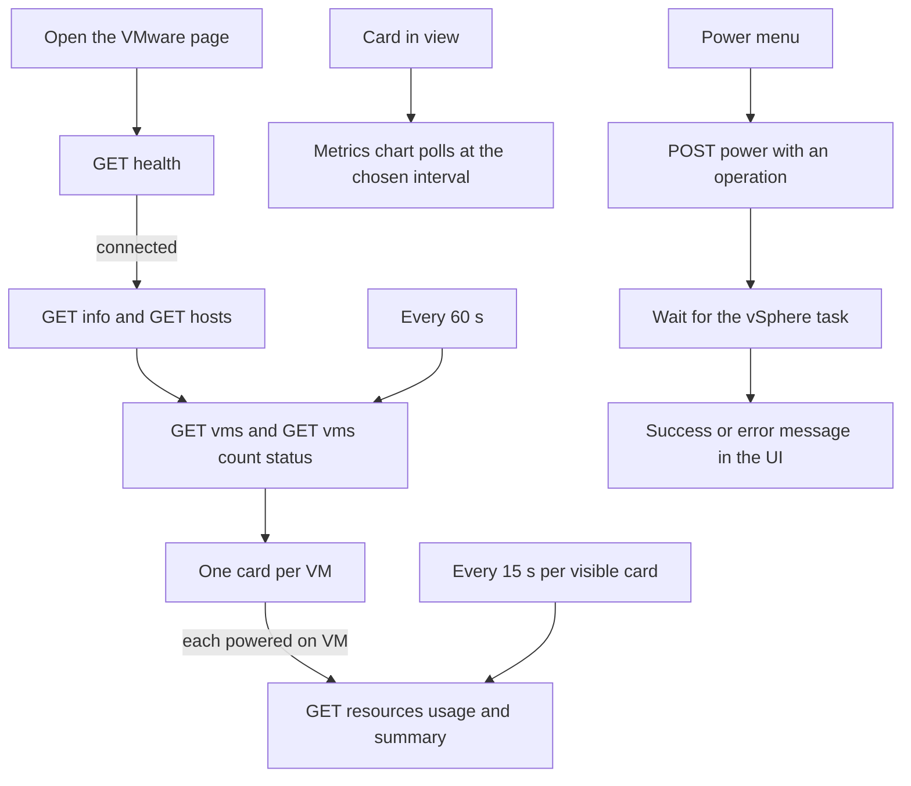
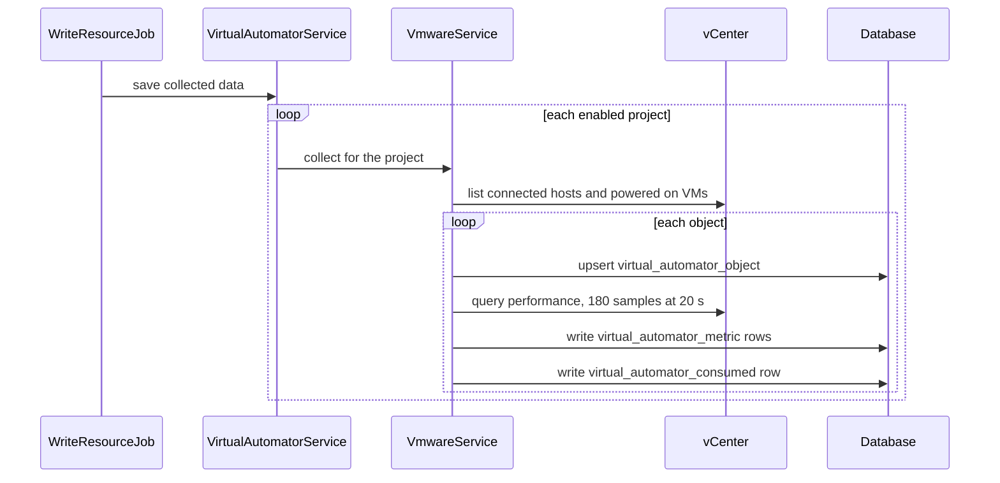
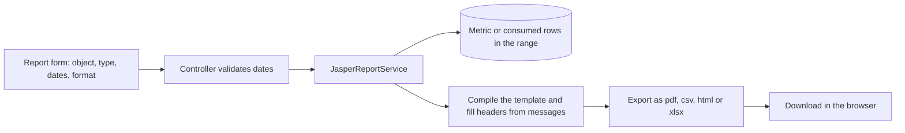

QWControl runs jobs against virtual machines, so it helps to see those machines in the same place: what is running, how loaded it is, and whether it is healthy. I built the VM Dashboard Monitor to answer that inside QWControl, next to the jobs that act on them.

The screenshots on this page come from the real interface, running against fake data.

## Three pieces that share only settings

The VMware work has three parts, and they do not call each other. They share the connection settings of the project: the vCenter address, the user, a path to the password in key storage and a flag for self signed certificates.

The browser talks only to the module, so it never needs credentials or network access to vSphere. The plugin side is for jobs: a step that clones a machine or a node source that lists virtual machines as nodes. The Proxmox side has its own steps and its own screens, without a node source.

## A request, end to end

Every request passes a license check before it reaches the hypervisor. The interceptor asks whether the VMware feature is present, and the menu item uses the same toggle, so an unlicensed installation does not show the entry. The [license module](/work/qwcontrol-platform-modules/) sets those toggles from the licensed module list.

## The host view

The first tab is the physical host: vendor, model, CPU, memory, uptime and health, with restart and shutdown buttons when the connection allows it. Below that, the resource monitor draws CPU, memory, disk and network for the selected interval, from real time up to the longer windows that vSphere keeps.

## The virtual machine view

The second tab, shown at the top of this page, is the one operators keep open. Counters show how many VMs are powered on, off or suspended, a donut chart splits the fleet by state and VMware Tools status, and three gauges compare CPU, memory and storage in use against what the host offers.

The filters cover power state, Tools status and tags, plus one that earns its place: machines that have been powered off for more than 30 days, the first candidates to reclaim. Filtering, sorting and the totals run in the browser. Each row has an actions menu for power operations: power on, power off, suspend, reset, and shutdown or reboot of the guest. A machine with a red alert gets a highlighted row so it stands out in a long list.

## What the module does to keep load down, and what it does not

The hypervisor is a shared system, so the module avoids asking it for things it does not need to ask. Two mechanisms are in place, and it helps to be exact about what each covers.

- **A short cache.** The list of hosts is cached for two minutes and the system information for ten, both per project.
- **Hourly sampling.** A scheduled job stores the metrics of hosts and powered on VMs, so reports read from QWControl instead of asking vSphere for history.

The list of virtual machines and the status counts are not cached. They go to vCenter on every request, and every request opens its own session, uses it and closes it. The interface refreshes the list every minute and polls the summary of each powered on VM every fifteen seconds while its card is visible. The cost grows with the number of VMs, so I would not claim this design for thousands of machines without a session pool, a cache on the VM list and a virtualized list in the browser. The scroller that would render only the visible cards exists in the code, switched off.

## Hourly collection

At the end of every hour, a Quartz job walks every enabled project. For each connected host and each powered on VM it reads the performance counters for CPU, memory, disk and network over the last hour at the 20 second sampling interval, and stores one row per series.

Three tables hold the result: the object, with its cores, memory and disk size, one row per metric series with the latest, minimum, maximum and average values, and one row per object with what it consumed. Nothing deletes old rows today, so a retention policy is the next thing this part needs.

## Reports

The same stored metrics feed report generation. You pick a host or a VM, a report type, a format and a date range. The module reads the rows for that range and fills a Jasper template, then returns a PDF, CSV, HTML or XLSX file.

The two types are consumed, the resources used by the object, and metrics, the series over time. The headers come from the same message files as the rest of the product, so reports follow the interface language.

## What I took from it

Most of the work went into deciding what the hypervisor should never be asked, and into being honest about what the first version still asks too often. Storing hourly samples was the right move, because it turned charts and reports into reads of our own tables. The next step is the same idea applied to the live list: one session and one cached inventory shared by every open browser.
