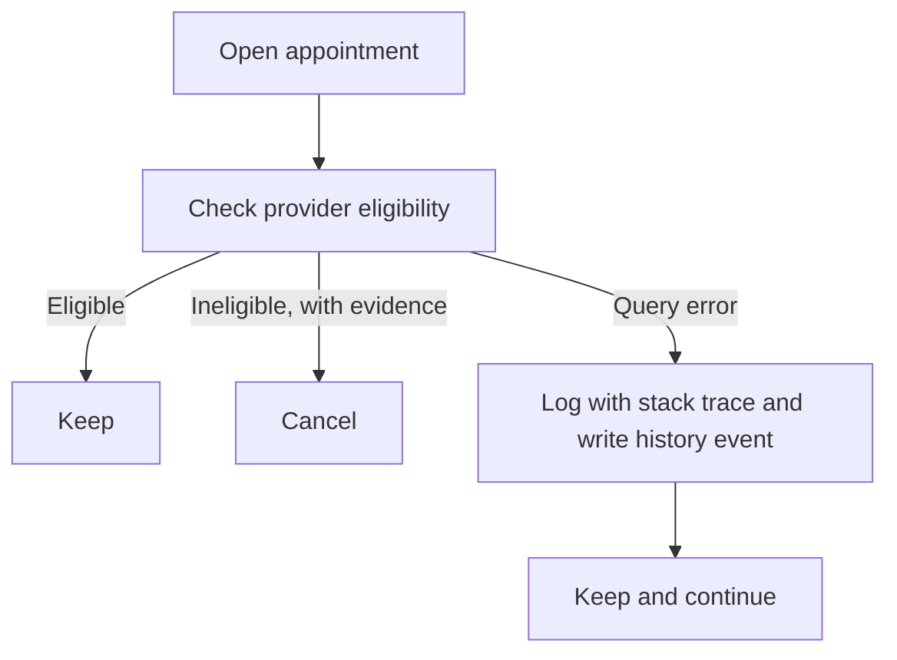

This was client work for a health plan operator in Brazil, so I only describe components and flows. The component is a telehealth appointment service with a job that runs every morning. It looks at open appointments and checks whether the provider is still eligible to see the patient. If the provider is not, the job cancels the appointment.

Cancellation cannot be undone. That one fact decides how every other part of this job should have been written, and for a while the job was not written that way.

## The invariant

The job exists to protect patients from appointments with providers who are no longer eligible: credentialing ended, the provider is blocked, there is no active specialty or address, or a current leave of absence. The invariant I would write on the wall is short: an appointment is cancelled only when the system has positive evidence that the provider is ineligible.

The code enforced a weaker rule: an appointment is cancelled unless the check says the provider is eligible.

## What was swallowed

The eligibility check queried a table in a legacy health plan system. The application's database account had no permission on those tables, so the query failed on every single run with a permission error.

The catch block around the check treated any exception as "ineligible". A permission error is an exception, so every appointment the job looked at was cancelled, and none of them for real ineligibility. The job went on for months. Every processed appointment in that period was cancelled.

In a way, the job was working. It ran on schedule, it processed appointments, it wrote history. Nothing crashed. The visible symptom was an outcome distribution that real eligibility data does not produce: 100% cancellations.

## Seeing it

The history of the appointments is where it shows. The outcome is the same for every row, and real ineligibility is unlikely to hit every provider. A job that cancels everything is not detecting anything. It is failing.

The logs were not much help either. A separate plan-name lookup, with the same kind of missing permission, flooded them with errors. A flood of identical errors is easy to learn to ignore, and a real signal can sit inside it.

## The fix

I made two changes.

First, I moved the validation to the database where provider data actually lives, the credentialed network database. The rules stayed the same, with parity checked against the old logic: credentialing, de-credentialing, blocking, active specialty and address, and current leave.

Second, errors no longer cancel anything. When the check fails, the job logs the error with its stack trace, writes a history event with an error code for the validation failure, and moves on to the next appointment. The appointment stays as it was.

The commit message says it in one sentence, and I still think it is the right rule: a query error is not evidence of ineligibility, and cancellation is irreversible.

For the plan-name lookup, I turned it off by configuration until the permission exists, and took the plan name from the network database instead. That stopped the log flood, which had been hiding the same kind of error that caused this bug.

## Tests

Two kinds of tests came with the fix. Characterization tests pin the eligibility rules, so the new validation behaves like the old one. And there is a test for the error path itself. It makes the check throw and asserts three things: nothing is cancelled, a history event is written, and the job keeps going with the next appointment.

The second test is the one that would have caught this. Tests of the rules alone cannot, because the rules were never the problem. The behavior on failure was just whatever the catch block did.

## A checklist for scheduled jobs

I now ask these questions about any job that runs unattended and takes an action:

- Can the action be undone? If not, the job needs positive evidence before acting, and "I could not check" is never evidence.
- Does an error produce the same result as a negative answer? If a catch block maps any exception to the "no" branch, the code is failing closed in the dangerous direction.
- Is there a test where the dependency throws? Rules are usually tested. Failures usually are not.
- What does an impossible outcome look like in the history? 100% cancellations, or 100% of anything, should be a signal.
- Would anyone notice? A job that processes records and reports success looks healthy even when it is wrong. An alert on extreme outcome ratios costs little and would have caught this on the first morning.
- Is there an off switch for a noisy dependency? A configuration flag to disable a lookup that has no permission is better than letting it flood the logs.

An alert on outcome ratios is the next thing I would add to this job. It needs a decision on what a normal day looks like, and I do not have that number yet.
